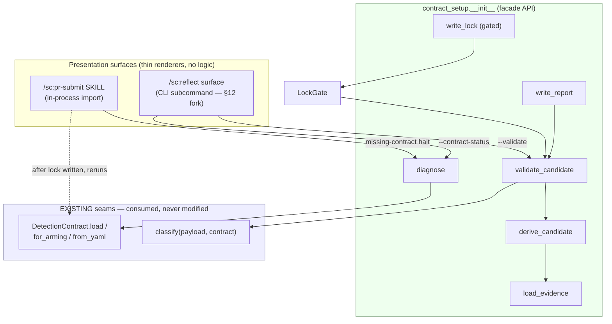
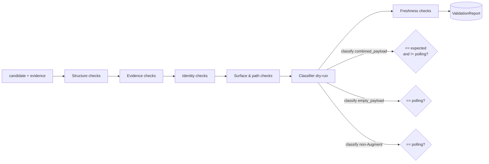
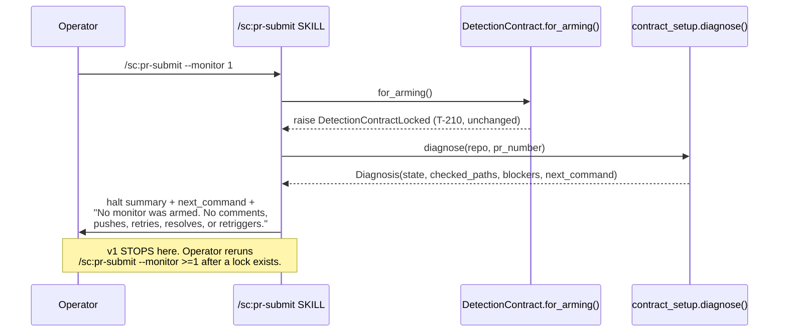
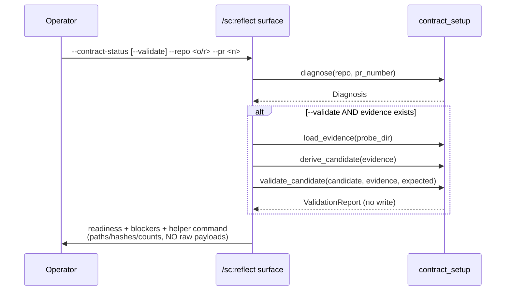

# Frozen authoritative planning input

Grounding: source-only. This is a retrospective/context-limited packet; historical research is unavailable to the generator and source revisions may contain later edits. No live implementation, baseline, rubric, research solution, execution result or QA verdict is supplied. Treat paths/line references within original specs as historical context, not verified current code. Build a plan against the substantive requirements; equivalent plan organization is acceptable. Human decision gates remain gates, not automatic approval.

## Verbatim source — .dev/brainstorms/20260701-142634-reflect-detection-contract-flow/design.md

---
title: "Component Design — Locked Detection Contract Setup Flow"
status: design-draft
type: component
source_requirements: ./merged-requirements.md
domain: code
created: 2026-07-01T14:48:00+00:00
target_module: src/superclaude/pr_submit/contract_setup/
---

# Component Design — Locked Detection Contract Setup Flow

Design deliverable for the merged requirements in
[`merged-requirements.md`](./merged-requirements.md). This document specifies the
component decomposition, data model, public interfaces, state machine, validation
pipeline, and integration seams. It is **design only** — no implementation bodies.
Implementation follows via `/sc:implement` after approval.

Every "existing seam" claim below is grounded in the current tree:

| Seam | Location | Contract (unchanged by this design) |
|---|---|---|
| `DetectionContract` dataclass | `src/superclaude/pr_submit/detection.py:79-199` | 11 classifier/config fields + `locked` (12 dataclass fields total) |
| `DetectionContract.load()` | `detection.py:147-188` | `(path, *, require_locked=True, prefer_local_override=False)` |
| `DetectionContract.for_arming()` | `detection.py:190-199` | `== load(prefer_local_override=True)` |
| `DetectionContract.from_yaml()` | `detection.py:119-145` | dict → contract, no lock enforcement |
| `DetectionContractLocked` | `detection.py:71-76` | the T-210 raise type |
| `classify()` | `classifier.py:158-232` | `(payload, contract, *, watermark=None) -> str` |
| Result literals | `classifier.py:23-26` | `"polling"` / `"clean"` / `"findings"` / `"declined"` |
| Resolution order | `detection.py:165-170` | explicit `path` → local override → shipped ref |
| Local override path | `detection.py:40` | `.dev/pr-monitor/detection-contract.locked.md` |
| T-210 gate | `detection.py:183-187` | `if require_locked and not contract.locked: raise` |

## 1. Scope and Non-Goals

### In scope

- A new Python package `superclaude.pr_submit.contract_setup` (facade import path
  fixed by requirements §5 metadata `generated_by: "superclaude.pr_submit.contract_setup"`).
- Read-only **diagnosis** of contract readiness (9 UX states, requirements §3).
- File-based **evidence loading** from captured probe JSON.
- **Candidate derivation** with per-field provenance that refuses required-unobserved fields.
- **Validation** via a dry-run of the *existing* `classify()` seam plus negative controls.
- **Report writing** and, only behind an explicit gate, **local-lock writing**.
- Integration wiring for the `/sc:pr-submit` halt message and a `/sc:reflect` readiness surface.

### Non-goals (design will actively prevent)

- **No change to `for_arming()` / `load()` / `classify()` semantics** (requirements §12 risk 1).
  This design *consumes* those seams; it never edits them.
- **No monitor arming, PR mutation, push, reply, resolve, retrigger, or resume** from any
  setup path (requirements §1.5, §9.5, §12 risk 7).
- **No default lock writing** — `write_lock` is the only writer and requires an explicit
  confirmation flag *plus* a passing gate (requirements §1.2, §10, §12 risk 4).
- **No classifier logic duplicated in skill markdown** — all derivation/validation lives in
  Python; skills render returned structs (requirements §12 risk 2).
- **No shipped-contract mutation** — the shipped ref stays `locked: false`; the only lock
  target is `.dev/pr-monitor/detection-contract.locked.md` (requirements §6.12, §13.12).

## 2. Component Architecture

The shared helper is decomposed into single-responsibility modules under a new package,
mirroring the ownership boundary in requirements §2 ("Shared helper owns: diagnosis, probe
loading, candidate derivation, validation, report + local-lock writing"). The package
`__init__.py` is the **facade** — the only import surface the two skills touch.

```text
src/superclaude/pr_submit/
├── detection.py            # EXISTING — unchanged (load/for_arming/from_yaml/DetectionContract)
├── classifier.py           # EXISTING — unchanged (classify + result literals)
└── contract_setup/         # NEW package (facade = superclaude.pr_submit.contract_setup)
    ├── __init__.py         # Facade: diagnose / load_evidence / derive_candidate /
    │                       #         validate_candidate / write_report / write_lock
    ├── states.py           # ContractState enum (9 states) + state-classification pure fn
    ├── diagnosis.py        # Diagnosis dataclass + diagnose() (read-only path/lock/evidence probe)
    ├── evidence.py         # EvidenceBundle dataclass + load_evidence() + sha256 + surface map
    ├── candidate.py        # CandidateContract + FieldProvenance + derive_candidate()
    ├── validation.py       # ValidationReport + CheckResult + validate_candidate() (dry-runs classify)
    ├── lockgate.py         # LockGate — the 12 §6 preconditions as ordered named checks
    ├── writer.py           # write_report() + write_lock() (gated, confirmation-required)
    └── questions.py        # SETUP_QUESTIONS declarative table (§4) + default-derivation binders
```



**Design rationale for a package (vs a single `contract_setup.py` module):** the ownership
boundary in requirements §2 lists six distinct responsibilities, and the safe-locking policy
(§6) plus validation checklist (§7) are large, independently testable units. A package keeps
each seam ≤ one screen and lets the regression suite (requirements §11.9) target modules
directly. The facade preserves a single import path (`superclaude.pr_submit.contract_setup`)
so callers are unaffected by the internal split.

> **Fork A (recommended = package).** If the reviewer prefers minimal surface area, the same
> API can ship as one `contract_setup.py` module; the facade signatures are identical either
> way. Recommended: package, for testability and SRP.

## 3. Data Model

All dataclasses are frozen where they are pure values; `Diagnosis`/`ValidationReport` carry a
`.summary()` that renders **status, paths, hashes, counts, blockers — never raw payload bodies**
(requirements §8, §12 risk 8).

### 3.1 `ContractState` (states.py) — requirements §3

```python
class ContractState(str, Enum):
    MISSING            = "missing"             # no local override; shipped fallback unlocked
    UNLOCKED           = "unlocked"            # a contract exists but locked: false
    UNPARSEABLE        = "unparseable"         # file exists, YAML cannot parse
    EVIDENCE_MISSING   = "evidence_missing"    # locked:true but probe_evidence missing/unreadable
    VALIDATION_MISSING = "validation_missing"  # evidence exists, no validation report
    VALIDATION_FAILED  = "validation_failed"   # validation report exists but failed
    STALE              = "stale"               # repo/PR/hash/freshness mismatch
    READY              = "ready"               # local locked contract validates against evidence
    DECLINED_BY_USER   = "declined_by_user"    # user cancelled setup
```

### 3.2 `Diagnosis` (diagnosis.py)

```python
@dataclass(frozen=True)
class Diagnosis:
    state: ContractState
    checked_paths: list[Path]          # every path probed, in resolution order (§9.3)
    override_present: bool             # .dev/pr-monitor/detection-contract.locked.md exists
    override_locked: bool | None       # None if unparseable/absent
    shipped_locked: bool               # always False in a healthy tree (asserted for drift)
    evidence_path: Path | None
    evidence_sha256: str | None
    repo: str | None                   # resolved owner/repo (may be None if unresolved)
    pr_number: int | None
    validation_report_path: Path | None
    validation_result: str | None      # "passed" | "failed" | None
    blockers: list[str]                # human-readable, ordered by severity
    next_command: str                  # the single safe rerun/setup command to print

    def summary(self) -> str: ...       # renders status+paths+hashes+counts+blockers, NO payloads
```

### 3.3 `EvidenceBundle` (evidence.py)

```python
@dataclass(frozen=True)
class EvidenceBundle:
    probe_dir: Path
    repo: str | None
    pr_number: int | None
    captured_at: str | None            # ISO-8601 from manifest, else file mtime
    surfaces: list[str]                # subset of {"reviews","comments","check_runs"} present
    reviews: list[dict]                # parsed; [] if surface absent
    comments: list[dict]
    check_runs: list[dict]
    combined_payload: dict             # the {"reviews":[...], "comments":[...]} classify() consumes
    sha256: str                        # hash of combined_payload canonical bytes
    pagination_complete: bool | None   # None = unknown (diagnosed + recorded, §7 evidence)
```

### 3.4 `FieldProvenance` + `CandidateContract` (candidate.py)

```python
@dataclass(frozen=True)
class FieldProvenance:
    value: object
    source: str          # "observed" | "default_suggested" | "user"
    observed: bool        # True only if resolved against payload metadata (not prose)
    evidence_ref: str | None   # json-path or file locus that backs an observed value

@dataclass(frozen=True)
class CandidateContract:
    contract: DetectionContract               # the real dataclass — reuses detection.py
    provenance: dict[str, FieldProvenance]    # keyed by contract field name
    expected_classifier_result: str           # "clean" | "findings" | "declined" (never "polling")

    def required_unobserved(self) -> list[str]: ...   # §6 must-never-guess fields lacking observed provenance
```

### 3.5 `CheckResult` + `ValidationReport` (validation.py)

```python
@dataclass(frozen=True)
class CheckResult:
    name: str            # stable id, e.g. "classifier_dry_run", "negative_control_empty"
    passed: bool
    detail: str          # short reason; never a raw payload body

@dataclass(frozen=True)
class ValidationReport:
    result: str                        # "passed" | "failed"
    classifier_result: str | None      # what classify() actually returned on the real payload
    expected_result: str
    checks: list[CheckResult]          # structure/evidence/identity/surface/classifier/freshness
    negative_controls: list[CheckResult]  # empty-payload + non-Augment must be "polling"
    decline_validation: str            # "passed" | "not_exercised" | "failed" (§4.12 policy)
    evidence_sha256: str
    validated_surfaces: list[str]
    blockers: list[str]

    def summary(self) -> str: ...       # paths/hashes/counts/blockers, NO payloads
```

## 4. Public Interface (facade — `contract_setup/__init__.py`)

Signatures + contracts only (pre/post-conditions), no bodies. Every function is **pure w.r.t.
side effects except the two writers**; `diagnose` / `validate_candidate` never write a lock and
never touch the network.

```python
def diagnose(
    *,
    repo: str | None = None,
    pr_number: int | None = None,
    cwd: Path | None = None,
) -> Diagnosis:
    """Read-only readiness probe. Resolves paths in the §9.3 order, classifies into one
    ContractState (§3), and derives the single safe next_command. NEVER writes, arms, or fetches.
    Post: result.state ∈ ContractState; result.blockers non-empty iff state ≠ READY."""

def load_evidence(probe_dir: Path) -> EvidenceBundle:
    """Load captured JSON from a probe dir (§8 layout). Computes sha256, maps present surfaces,
    diagnoses pagination completeness when derivable. Raises FileNotFoundError if no payload."""

def derive_candidate(
    evidence: EvidenceBundle,
    *,
    answers: "SetupAnswers | None" = None,
) -> CandidateContract:
    """Build a CandidateContract from observed evidence (+ optional operator answers, §4).
    Records provenance per field. Marks a §6 must-never-guess field 'observed' ONLY when it
    resolves against payload metadata. Post: candidate.required_unobserved() lists any gap."""

def validate_candidate(
    candidate: CandidateContract,
    evidence: EvidenceBundle,
    *,
    expected_result: str,
) -> ValidationReport:
    """Run the §7 checklist. Dry-runs the EXISTING classify(evidence.combined_payload,
    candidate.contract) — never a reimplementation — and asserts == expected_result and
    ≠ "polling". Runs empty-payload + non-Augment negative controls. NEVER writes."""

def write_report(
    report: ValidationReport,
    evidence: EvidenceBundle,
    dest_dir: Path,
) -> Path:
    """Write validation-report.yaml + validation-summary.md under the probe dir (§8).
    Idempotent overwrite. Returns the report path. This is NOT the lock writer."""

def write_lock(
    candidate: CandidateContract,
    evidence: EvidenceBundle,
    report: ValidationReport,
    *,
    confirmed: bool,
    dest: Path = Path(".dev/pr-monitor/detection-contract.locked.md"),
) -> Path:
    """The ONLY writer of a locked:true contract. Evaluates LockGate (§6, all 12 preconditions).
    Raises ContractSetupRefused unless gate.passed AND confirmed is True. Refuses any dest that
    is not under .dev/pr-monitor/ (§6.12) — never the shipped ref, never a .claude/ mirror.
    Writes the §5 YAML + metadata block. Returns the lock path. NEVER arms the monitor."""
```

`SetupAnswers` (questions.py) is a plain dataclass holding the resolved answers to the §4
sequence; `None` means "derive all defaults from evidence."

## 5. UX State Machine (requirements §3)

`diagnose()` is a pure classifier over three observations: (a) which contract path resolved,
(b) whether it parses + is `locked`, (c) whether its `probe_evidence` + validation report exist
and are fresh. The transitions below are the decision tree `diagnose()` encodes.

```mermaid
stateDiagram-v2
    [*] --> resolve
    resolve --> MISSING: no override AND shipped is fallback
    resolve --> UNPARSEABLE: file exists, YAML fails
    resolve --> UNLOCKED: parses, locked=false
    resolve --> lockedTrue: parses, locked=true

    lockedTrue --> EVIDENCE_MISSING: probe_evidence absent/unreadable
    lockedTrue --> hasEvidence: probe_evidence readable

    hasEvidence --> STALE: repo/PR/hash/age mismatch
    hasEvidence --> VALIDATION_MISSING: no validation report
    hasEvidence --> VALIDATION_FAILED: report.result == failed
    hasEvidence --> READY: report.result == passed AND fresh

    UNLOCKED --> [*]: validate candidate if evidence exists
    READY --> [*]: /sc:pr-submit --monitor >=1 may proceed (existing gate)
    note right of DECLINED_BY_USER: entered only from an interactive\nsetup cancel; leaves contract untouched
```

Default action per state is carried in `Diagnosis.next_command` and rendered by the skill —
never executed by the helper. Mapping to requirements §3 "Default action" column is 1:1.

## 6. Setup Question Sequence (requirements §4)

The 16-question sequence is encoded **declaratively** in `questions.py` so the skill markdown
renders prompts and the Python owns default-derivation (requirements §12 risk 2). No question
logic lives in markdown.

```python
@dataclass(frozen=True)
class SetupQuestion:
    id: str                       # "repo", "probe_pr", "operation", ... (§4 order)
    prompt: str
    derive_default: Callable[[EvidenceBundle | None, SetupAnswers], object | None]
    required_for_lock: bool       # true for §6 must-never-guess fields
    lockable_only_if_observed: bool

SETUP_QUESTIONS: list[SetupQuestion] = [ ... 16 entries ... ]
```

Key binding rules (from §4 + §6):

- `repo` (Q1) default = resolved origin `owner/repo`; unresolved → require explicit value.
- `operation` (Q3) default is **surface-specific**: `/sc:reflect` → *diagnose only*; setup helper
  → *capture/validate/offer write*; `/sc:pr-submit` halt → *print setup command and stop*.
- `emission_shape` (Q8), `findings_locus` (Q9), `review_completeness_signal` (Q11),
  `augment_bot_login`/identity (Q6), `probe_evidence`, repo binding — `lockable_only_if_observed = True`.
  `derive_candidate` refuses to mark these observed unless they resolve against payload metadata.
- `run_validation` (Q14) default = yes; **required** before any `locked: true`.
- `write_local_locked_contract` (Q15) default = **no**; requires explicit confirmation post-validation.
- `next_step` (Q16) prints absolute artifact paths + the `/sc:pr-submit --monitor >=1` command;
  **does not execute it**.

## 7. Safe-Locking Gate (requirements §6)

`LockGate` (lockgate.py) is an **ordered list of 12 named predicates** — one per §6 precondition.
`write_lock` calls `LockGate.evaluate(...)` and refuses on the first failure; the gate returns
*all* failures for the report.

| # | Check id | Predicate (fails → block) | Source |
|---|---|---|---|
| 1 | `evidence_readable` | `EvidenceBundle` loaded, combined_payload non-null | §6.1 |
| 2 | `evidence_repo_bound` | `evidence.repo == candidate repo` | §6.2 |
| 3 | `pr_identity_recorded` | `evidence.pr_number` set; cross-PR flagged shape-only | §6.3 |
| 4 | `identity_observed` | bot/app identity in payload metadata, not prose | §6.4 |
| 5 | `emission_shape_observed` | selected `emission_shape` present in payload | §6.5 |
| 6 | `paths_resolve` | findings locus / completion signal resolve vs evidence | §6.6 |
| 7 | `expected_not_polling` | `expected_classifier_result ∈ {clean,findings,declined}` | §6.7 |
| 8 | `classifier_matches` | `classify(payload, contract) == expected` | §6.8 |
| 9 | `negative_controls_pass` | empty + non-Augment payload → `polling` | §6.9 |
| 10 | `report_written` | validation report exists, references evidence hash | §6.10 |
| 11 | `user_confirmed` | explicit `confirmed=True` | §6.11 |
| 12 | `dest_under_pr_monitor` | dest path under `.dev/pr-monitor/`, not shipped/`.claude/` | §6.12 |

```python
@dataclass(frozen=True)
class GateResult:
    passed: bool
    failures: list[CheckResult]     # empty iff passed

class LockGate:
    @staticmethod
    def evaluate(candidate, evidence, report, *, confirmed: bool, dest: Path) -> GateResult: ...
```

**Must-never-guess enforcement:** checks 4/5/6 consult `candidate.provenance` and require
`observed=True`. §6's "acceptable only as suggestions" defaults (bot login display, app slug,
findings path names, decline regex, freshness threshold) may seed prompts but can never satisfy
an `observed` requirement on their own.

## 8. Validation Pipeline (requirements §7)

`validate_candidate()` runs six check groups, each emitting `CheckResult`s. The classifier group
is the load-bearing one and it **reuses `classify()` verbatim** — the design never re-derives
classification (requirements §12 risk 2).



- **Structure** (§7.1): YAML parses; required fields present; no placeholders in required fields;
  candidate loads through the *existing* `DetectionContract.from_yaml()`; shipped ref still `locked:false`.
- **Evidence** (§7.2): payload under `.dev/pr-monitor/probes/` (or copied there); hash recorded;
  repo + PR recorded; capture time recorded; surfaces recorded; pagination diagnosed when known.
- **Identity** (§7.3): selected actor/app appears in payload metadata; copied human text ignored;
  multiple candidates require explicit selection.
- **Surface & path** (§7.4): selected surface present; findings locus resolves when findings exist;
  completion signal resolves for clean evidence; severity path resolves if non-null; check-run status
  terminal before use as completion.
- **Classifier dry-run** (§7.5): `classify(combined_payload, contract) == expected != "polling"`;
  empty payload → `polling`; non-Augment payload → `polling`; decline evidence (when present) →
  `declined`, distinct from `clean`/`polling`.
- **Freshness** (§7.6): repo mismatch blocks; missing evidence file/hash blocks; same PR preferred;
  cross-PR requires explicit confirm + validates shape only; **age warning default = 30 days**.

## 9. Output Artifact Layout (requirements §8)

`write_report` / `write_lock` write only under `.dev/pr-monitor/` (gitignored — `.gitignore:243`).

```text
.dev/pr-monitor/
  detection-contract.locked.md              # write_lock target (only after gate+confirm)
  probes/
    <YYYYMMDD-HHMMSS>-pr-<number>/
      gh-reviews.json                        # captured surface payloads (V2 live / V1 provided)
      gh-comments.json
      gh-check-runs.json
      combined-payload.json                  # the {"reviews","comments"} classify() consumes
      candidate.detection-contract.md        # derive_candidate output (with provenance comments)
      validation-report.yaml                 # write_report output (§5 metadata + checks)
      validation-summary.md                  # human summary: status/paths/hashes/counts/blockers
```

The locked contract's YAML block is exactly the §5 classifier-critical schema **plus** the §5
`metadata:` extension (schema_version, generated_by, generated_at, repo, pr_number, evidence_sha256,
validation_report, validation_result, validation_classifier_result, validated_surfaces,
decline_validation). The classifier ignores `metadata` — it is provenance only.

## 10. Integration Design

### 10.1 `/sc:pr-submit` missing-contract halt (requirements §9)

`for_arming()` still raises `DetectionContractLocked` on `locked:false` (unchanged). The skill
catches it and calls `diagnose()` to render a better halt — **it never arms after setup in v1**.



Halt message contents (requirements §9.2-9.5): resolved status, checked paths, setup/diagnose
command, and the literal invariant line *"No monitor was armed…"*. After a lock is written by the
separate setup flow, a rerun simply re-enters the **unchanged** `for_arming()` path (requirements §9 close).

### 10.2 `/sc:reflect` readiness surface (requirements §10)

`/sc:reflect` gains a **diagnose/validate-first** path. It **never** writes a lock and **never** arms
(requirements §10 v1, §12 risk 4).



### 10.3 Presentation-surface decision — **Fork B**

`/sc:reflect` currently has a Click group `reflect_group` (`cli/reflect/commands.py`) with a
`reflect run` subcommand, and **no** current linkage to detection code. `/sc:pr-submit` has **no**
CLI subcommand and imports `superclaude.pr_submit` in-process.

| Option | Reflect surface | Pros | Cons |
|---|---|---|---|
| **B1 (recommended)** | New `superclaude reflect contract-status [--validate] --repo --pr` subcommand calling the facade | Matches existing `reflect_group`; unit-testable via `CliRunner`; keeps logic out of markdown | Adds one CLI subcommand + option wiring |
| B2 | Skill-markdown flag only; skill imports facade in-process (like pr-submit) | Zero CLI change; symmetric with pr-submit | Harder to test headlessly; more markdown orchestration |

**Recommendation: B1** for reflect (testability + existing group), and **in-process import** for the
`/sc:pr-submit` halt (matches how it already imports `for_arming()`). Both call the same facade, so
the choice is presentation-only and does not change the component design.

## 11. Error / Refusal Model

```python
class ContractSetupError(RuntimeError): ...          # base
class ContractSetupRefused(ContractSetupError): ...  # write_lock gate failed or unconfirmed
class EvidenceUnreadable(ContractSetupError): ...    # load_evidence could not parse/hash
```

- `write_lock` raises `ContractSetupRefused` (never silently no-ops) when the gate fails or
  `confirmed` is false — the caller renders the blockers.
- `diagnose` never raises on a bad contract; it classifies the failure into a `ContractState`
  (`UNPARSEABLE` / `EVIDENCE_MISSING` / …) so the halt path is always actionable.
- The existing `DetectionContractLocked` is **not** re-purposed; it remains the arm-gate signal only.

## 12. Test Design → Acceptance Criteria (requirements §11, §13)

New tests live under `tests/pr_submit/` alongside the existing `test_detection_contract.py`.
Traceability:

| Acceptance criterion (§13) | Design element | Test |
|---|---|---|
| 1. shipped-only still halts | unchanged `for_arming()`; diagnose(state=MISSING/UNLOCKED) | `test_shipped_only_halts_and_diagnoses` |
| 2. halt names override + setup path | `Diagnosis.next_command`, `checked_paths` | `test_halt_message_actionable` |
| 3. `--monitor 0` unaffected | no integration on ordinal-0 path | `test_monitor_0_unaffected` |
| 4. defaults alone cannot lock | `LockGate` checks 4/5/6 require `observed` | `test_defaults_cannot_lock` |
| 5. `polling` cannot lock | `LockGate.expected_not_polling` + `classifier_matches` | `test_polling_expected_refused` |
| 6. wrong-repo cannot lock | `LockGate.evidence_repo_bound` | `test_wrong_repo_blocks_lock` |
| 7. cross-PR shape-only | `derive_candidate` cross-PR flag; freshness check | `test_cross_pr_shape_only` |
| 8. non-Augment copied text ignored | identity check; negative control | `test_non_augment_text_ignored` |
| 9. decline/clean/no-evidence distinct | `validate_candidate` classifier group | `test_states_distinguished` |
| 10. reflect no raw payloads | `.summary()` renders paths/hashes only | `test_reflect_summary_no_payloads` |
| 11. lock only under `.dev/pr-monitor/` after confirm | `write_lock` + `dest_under_pr_monitor` + `confirmed` | `test_lock_path_and_confirm_gate` |
| 12. shipped stays unlocked/generic | structure check asserts shipped `locked:false` | `test_shipped_remains_unlocked` |
| §11.9 regressions | T-210 preserved; local-override preference; wrong/stale evidence; no side effects | reuse + extend `test_detection_contract.py` |

**Critical invariant test:** `test_no_monitor_side_effects` asserts no setup path imports/calls any
arming, `Monitor`, push, reply, resolve, or retrigger symbol (grep-style guard, mirroring the
existing purity assertions).

## 13. Minimal Implementation Order (requirements §11)

Design supports the requirements' staged plan directly:

1. `states.py` + `diagnosis.py` → `diagnose()` (read-only; powers the better halt).
2. Wire `/sc:pr-submit` halt to `diagnose()` (monitor stays unarmed).
3. `evidence.py` → `load_evidence()` (file-based, captured JSON).
4. `candidate.py` → `derive_candidate()` (provenance + required-unobserved refusal).
5. `validation.py` → `validate_candidate()` (dry-run `classify` + negative controls).
6. `lockgate.py` + `writer.py` → `write_lock()` (gated, confirmation-required).
7. `/sc:reflect` `contract-status` surface (diagnose/validate-first; no writes).
8. Optional live GitHub capture (V2; all `gh` calls pin `--repo <owner/repo>`).
9. Regression tests per the §12 traceability matrix.

## 14. Open Decisions for Approval

1. **Fork A — helper granularity:** package (recommended) vs single module. Facade identical.
2. **Fork B — reflect surface:** new `superclaude reflect contract-status` CLI subcommand
   (recommended) vs skill-markdown flag calling the in-process facade.
3. **Live capture (V2) timing:** design includes the `EvidenceBundle` seam so live capture is a
   later `load_evidence` source; confirm V2 is out of this design's build scope (requirements §11.8
   treats it as optional/after file-based validation).

No `for_arming()` / `classify()` semantics change under any option above.

## 15. Requirements Traceability Summary

| Requirements § | Covered by |
|---|---|
| §1 recommended behavior | §1 scope, §10 integration, §7 gate |
| §2 ownership boundary | §2 module decomposition (facade = shared helper) |
| §3 UX states | §3.1 enum, §5 state machine |
| §4 question sequence | §6 declarative `SETUP_QUESTIONS` |
| §5 contract fields | §9 YAML block + `metadata` |
| §6 safe-locking policy | §7 `LockGate` (12 checks) |
| §7 validation checklist | §8 validation pipeline (6 groups) |
| §8 output artifacts | §9 layout + writers |
| §9 pr-submit integration | §10.1 sequence |
| §10 reflect integration | §10.2 sequence + §10.3 surface |
| §11 implementation plan | §13 order |
| §12 risks/mitigations | §1 non-goals, §11 error model, §8 classify reuse |
| §13 acceptance criteria | §12 test matrix |


## Verbatim source — .dev/brainstorms/20260701-142634-reflect-detection-contract-flow/merged-requirements.md

---
title: "Locked Detection Contract Setup Flow for /sc:reflect and /sc:pr-submit"
status: brainstorm-merged
domain: code
strategy: systematic
convergence_score: 0.87
created: 2026-07-01T14:26:34+00:00
---

# Locked Detection Contract Setup Flow for `/sc:reflect` and `/sc:pr-submit`

## 1. Recommended Product Behavior

Implement a shared, evidence-first contract setup helper and integrate it conservatively:

1. `/sc:pr-submit --monitor >=1` keeps the existing fail-closed arming gate. If no locked contract resolves, it stops before arming and prints a structured diagnosis plus the next safe setup command.
2. `/sc:reflect` gains a contract-readiness diagnostic/reporting path. In v1 it should diagnose and validate readiness; it should not write the local locked contract by default.
3. A shared helper under `src/superclaude/pr_submit/` owns contract diagnosis, probe evidence loading/capture, candidate derivation, classifier validation, validation reports, and local locked-contract writing.
4. The shipped detection contract remains `locked: false` and generic. Repo/operator-specific locked data lives only under `.dev/pr-monitor/`.
5. Contract creation never arms the monitor, posts comments, pushes, resolves threads, retries, retriggers, or resumes `/sc:pr-submit` without an explicit separate confirmation.

## 2. Ownership Boundary

### `/sc:pr-submit`

Owns:

- PR creation and monitor ordinal behavior.
- Monitor arming.
- Poll loop, FSM, retry/retrigger, validation, push/reply/resolve side effects.
- The fail-closed check that refuses to arm unless `DetectionContract.for_arming()` resolves a locked contract.

New behavior:

- On missing/unusable locked contract, call the shared diagnosis helper to render a better halt message.
- Offer a setup command or optional interactive setup entry, defaulting to stop.
- Do not continue into monitor arming after setup in v1; tell the operator to rerun `/sc:pr-submit --monitor >=1`.

### `/sc:reflect`

Owns:

- Readiness diagnostics.
- Optional validation reporting against existing probe evidence.
- Concise status output that does not dump raw GitHub payload bodies.

Does not own in v1:

- Default contract writing.
- Monitor arming.
- PR mutation or monitor resume.

### Shared helper

Owns:

- Contract state diagnosis.
- Probe payload loading and later optional capture.
- Candidate derivation from observed evidence.
- Validation through existing classifier/poll seam.
- Validation report and local lock writing.

## 3. UX States

The helper should classify contract readiness into explicit states:

| State | Meaning | Default action |
|---|---|---|
| `missing` | No local override exists; shipped fallback is unlocked | Print setup command and stop |
| `unlocked` | Local or shipped contract exists but `locked: false` | Validate candidate if evidence exists |
| `unparseable` | Contract file exists but YAML cannot parse | Preserve file; offer regenerate from evidence |
| `evidence_missing` | `locked: true` exists but `probe_evidence` missing/unreadable | Re-probe or revalidate before use |
| `validation_missing` | Evidence exists but no validation report | Run validation |
| `validation_failed` | Validation report exists but failed | Show blockers and alternatives |
| `stale` | Repo/PR/hash/freshness policy mismatch | Revalidate or recapture |
| `ready` | Local locked contract validates against evidence | `/sc:pr-submit --monitor >=1 --pr <number>` may proceed through existing gate when supplied the existing PR number |
| `declined_by_user` | User cancels setup | Leave existing contract untouched |

## 4. Proposed Question Sequence With Defaults

The setup flow should ask a bounded sequence. Defaults may be accepted only when evidence supports them.

1. **Repository** — “Use resolved repo `<owner/repo>`?”
   - Default: current resolved origin repo.
   - Required for provenance and all `gh` calls.
   - If unresolved, require explicit `owner/repo`.

2. **Probe PR** — “Which PR contains a recent Augment-authored payload?”
   - Default: current PR if known.
   - Required for evidence provenance.

3. **Operation** — “Diagnose only, validate existing evidence, or capture/validate/offer write?”
   - `/sc:reflect` default: diagnose only.
   - setup helper default: capture/validate/offer write.
   - `/sc:pr-submit` missing-contract halt default: print setup command and stop.

4. **Evidence source** — “Fetch current GitHub payloads or use existing captured JSON?”
   - V1 default: use existing captured JSON or file-based validation path.
   - V2 optional: fetch current state using pinned `--repo <owner/repo>`.

5. **Surfaces to inspect** — “PR reviews, issue comments, check runs, or all?”
   - Default: all supported surfaces.
   - Omitted surfaces are recorded in validation report.

6. **Detected Augment identity** — “Lock this observed bot/app identity?”
   - Default: exactly one observed Augment-authored identity.
   - If multiple candidates, require explicit selection.
   - If no observed identity, stop; do not lock.

7. **Author association values** — “Use these observed author associations?”
   - Default: observed values.
   - If absent, empty is allowed only if classifier validation does not require it.

8. **Emission shape** — “Which observed surface is primary?”
   - Options: `review`, `issue_comment`, `check_run`.
   - Default: surface with decisive observed findings/completion signal.
   - Cannot lock an unobserved surface.

9. **Findings locus** — “Use this observed field path?”
   - Defaults by surface are internal classifier paths such as `<review-findings-field>`, `<comment-findings-field>`, or `<check-run-findings-field>`; raw body-bearing JSON paths are never printed in readiness/status summaries.
   - Must resolve against captured payload when findings are present, while normal summaries report only path-resolution status/counts rather than the raw field path or payload body.

10. **Severity field path** — “Use this observed severity path or `null`?”
    - Default: observed machine-readable path if present, else `null`.
    - Absence is allowed, but report must record that severity was not field-backed.

11. **Review completeness signal** — “What observed signal means review is complete?”
    - Default: observed terminal review state, summary marker, or completed check-run conclusion/output marker.
    - Must distinguish complete from pending/polling.

12. **Decline detection fields** — “Use existing decline defaults and validate if evidence exists?”
    - Defaults: current regex/trigger values from the shipped contract.
    - V1 policy: lack of decline sample emits warning `decline_validation: not_exercised`; it does not block an otherwise validated lock.

13. **Expected classifier result** — “What should the captured payload classify as?”
    - Default from evidence: `findings`, `clean`, or `declined`.
    - `polling` is never lockable.

14. **Run validation** — “Dry-run existing classifier against captured payload and candidate?”
    - Default: yes.
    - Required before `locked: true`.

15. **Write local locked contract** — “Write `.dev/pr-monitor/detection-contract.locked.md`?”
    - Default: no.
    - Requires explicit confirmation after validation passes.
    - Does not arm monitor.

16. **Next step** — “Print rerun command?”
    - Default: yes.
    - Print absolute artifact paths and the recommended `/sc:pr-submit --monitor >=1 --pr <number>` command for an existing PR; do not execute it.

## 5. Contract Fields

Preserve the existing classifier-critical schema:

```yaml
augment_bot_login: "<observed>"
augment_author_association: ["<observed>"]
augment_app_slug: "<observed-or-null>"
emission_shape: "<review|issue_comment|check_run>"
findings_locus: "<observed-json-path>"
severity_field_path: "<observed-json-path-or-null>"
review_completeness_signal: "<observed-terminal-signal>"
probe_evidence: "<path-to-captured-payload>"
decline_phrase_regex: 'abnormally\s+large'
decline_retrigger_regex: 'comment\s+["''`*_]*(augment|auggie|augmentcode)\s+review["''`*_]*'
accepted_trigger_phrases: ["auggie review", "augment review", "augmentcode review"]
locked: true
```

Recommended v1 metadata extension, ignored by the classifier:

```yaml
metadata:
  schema_version: "1.0"
  generated_by: "superclaude.pr_submit.contract_setup"
  generated_at: "<ISO-8601>"
  repo: "<owner/repo>"
  pr_number: <number>
  evidence_sha256: "<sha256>"
  validation_report: "<path>"
  validation_result: "passed"
  validation_classifier_result: "<clean|findings|declined>"
  validated_surfaces: ["reviews", "comments", "check_runs"]
  decline_validation: "passed|not_exercised|failed"
```

## 6. Safe Locking Policy

A contract may be written with `locked: true` only when all are true:

1. Evidence payload exists and is readable.
2. Evidence is tied to the resolved repo.
3. PR identity is recorded; cross-PR evidence is explicit and can validate shape only, not current review state.
4. An Augment-authored actor/app identity is observed in payload metadata, not prose alone.
5. Selected emission shape is observed.
6. Required findings or completion signal paths resolve against evidence.
7. Expected classifier result is `clean`, `findings`, or `declined`, never `polling`.
8. Existing classifier/poll seam returns the expected result with the candidate contract.
9. Non-Augment or empty-payload negative controls do not falsely classify as reviewed.
10. Validation report is written and references evidence hash.
11. User explicitly confirms writing the local lock.
12. Target path is `.dev/pr-monitor/detection-contract.locked.md`, never the shipped ref and never `.claude/` mirrors.

Defaults that are acceptable only as suggestions:

- Common bot login display.
- Common app slug.
- Common findings path names.
- Decline regex defaults.
- Freshness threshold.

Values that must never be guessed for `locked: true`:

- `augment_bot_login` / app identity.
- `emission_shape`.
- `findings_locus` when findings exist.
- `review_completeness_signal`.
- `probe_evidence`.
- Repo binding.

## 7. Validation Checklist

### Structure

- YAML parses.
- Required fields exist.
- No placeholders remain in required fields.
- Candidate loads through existing `DetectionContract.from_yaml()`.
- Shipped contract remains `locked: false`.

### Evidence

- Payload file exists under `.dev/pr-monitor/probes/` or is copied there.
- Evidence hash is recorded.
- Repo and PR are recorded.
- Capture time is recorded.
- Surfaces inspected are recorded.
- Pagination/incompleteness is diagnosed when known.

### Identity

- Selected actor/app appears in payload metadata.
- Similar human-authored or copied text is ignored.
- Multiple candidates require explicit selection.

### Surface and path

- Selected surface exists in payload.
- Findings locus resolves when findings exist.
- Completion signal resolves for clean/no-findings evidence.
- Severity path resolves if non-null.
- Check-run status is terminal before using it as completion.

### Classifier dry run

- Candidate + payload returns expected non-`polling` state.
- Empty payload does not classify as reviewed.
- Non-Augment-authored payload does not classify as reviewed.
- Decline evidence, when present, returns `declined` and remains distinct from `clean` and `polling`.

### Freshness

- Repo mismatch blocks lock.
- Missing evidence file/hash blocks lock.
- Same PR is preferred.
- Cross-PR evidence requires explicit confirmation and only validates contract shape.
- Age warning defaults to 30 days in v1 unless project policy tightens it.

## 8. Output Artifacts

All generated artifacts go under:

```text
/config/workspace/IronClaude/.dev/pr-monitor/
```

Recommended layout:

```text
/config/workspace/IronClaude/.dev/pr-monitor/
  detection-contract.locked.md
  probes/
    <YYYYMMDD-HHMMSS>-pr-<number>/
      gh-reviews.json
      gh-comments.json
      gh-check-runs.json
      combined-payload.json
      candidate.detection-contract.md
      validation-report.yaml
      validation-summary.md
```

Normal `/sc:reflect` and `/sc:pr-submit` summaries should display status, artifact paths, hashes, path-resolution counts, and blockers, not raw payload bodies or body-bearing classifier paths.

## 9. `/sc:pr-submit` Integration

When `--monitor >=1` and no locked contract resolves:

1. Preserve current halt.
2. Run diagnosis helper.
3. Print checked paths and status.
4. Print setup/diagnose command.
5. State: “No monitor was armed. No comments, pushes, retries, resolves, or retriggers were performed.”

Example next step text:

```text
Next safe step:
  superclaude reflect contract-status --repo <owner/repo> --pr <number>

Or validate captured evidence with:
  superclaude reflect contract-status --validate --repo <owner/repo> --pr <number>
```

After a lock is written, `/sc:pr-submit --monitor >=1` should simply rerun the existing `DetectionContract.for_arming()` path.

## 10. `/sc:reflect` Integration

Add a narrow readiness path:

```text
superclaude reflect contract-status --repo <owner/repo> --pr <number>
superclaude reflect contract-status --validate --repo <owner/repo> --pr <number>
```

In v1:

- Diagnose contract state.
- Validate existing evidence if requested.
- Print readiness and blockers.
- Recommend helper command.
- Do not write local lock by default.
- Do not arm monitor.

## 11. Minimal Implementation Plan

1. **Add structured diagnosis helper** near `src/superclaude/pr_submit/detection.py` without changing `for_arming()` semantics.
2. **Improve `/sc:pr-submit` halt message** using diagnosis output; keep monitor unarmed.
3. **Add file-based probe validation** that consumes captured JSON fixtures and writes validation reports under `.dev/pr-monitor/probes/`.
4. **Add candidate contract builder** that records field provenance and refuses required unobserved fields.
5. **Validate through existing classifier** with expected result and negative controls.
6. **Add safe writer** for `.dev/pr-monitor/detection-contract.locked.md`, explicit confirmation required.
7. **Add `/sc:reflect` contract status reporting** as diagnose/validate-first, not write-first.
8. **Add optional GitHub capture** after file-based validation is tested; all capture commands must pin `--repo <owner/repo>`.
9. **Add regression tests** for T-210, local override preference, wrong/stale evidence, non-Augment copied text, and no monitor side effects.

## 12. Risks and Mitigations

| Risk | Mitigation |
|---|---|
| Arming gate weakened | Do not change `DetectionContract.for_arming()` semantics; add regression tests |
| Skill markdown duplicates classifier | Keep derivation/validation in Python helper; skills render results |
| Defaults become accidental guesses | Field provenance; lock requires observed/validated status |
| `/sc:reflect` scope creep | Diagnose/validate-first v1; no default writes or monitor side effects |
| Live `gh` assumptions wrong | File-based validation first; live capture second |
| Stale/wrong evidence locks contract | Repo/hash mismatch blocks; cross-PR explicit and shape-only |
| Operator confuses lock with monitor armed | Always print “No monitor was armed” after setup |
| Probe payload leakage | Summaries show paths/hashes/status and path-resolution counts, not raw payload bodies or body-bearing classifier paths |

## 13. Acceptance Criteria

1. `/sc:pr-submit --monitor >=1` still halts with only shipped `locked:false` contract.
2. Halt message is actionable and names the local override and setup/diagnose path.
3. `/sc:pr-submit --monitor 0` remains unaffected.
4. Defaults alone cannot produce `locked: true`.
5. Candidate with classifier result `polling` cannot lock.
6. Wrong-repo evidence cannot lock.
7. Cross-PR evidence is explicit and cannot assert current PR review completion.
8. Non-Augment-authored copied text is ignored.
9. Decline, no-findings, and no-evidence are distinguished when fixtures exist.
10. `/sc:reflect` reports readiness without dumping raw payloads.
11. Local locked contract is written only under `.dev/pr-monitor/` after confirmation.
12. Shipped contract remains unlocked and generic.


## Binding human supplement (selected source excerpts only)

Source excerpt: .dev/tasks/to-do/TASK-RF-detection-contract-20260701-164700/BUILD-REQUEST.md, lines 3-5

GOAL: Build an MDTM task file to implement the locked detection contract setup flow described in `/config/workspace/IronClaude/.dev/brainstorms/20260701-142634-reflect-detection-contract-flow/design.md`, using `/config/workspace/IronClaude/.dev/brainstorms/20260701-142634-reflect-detection-contract-flow/merged-requirements.md` as the source requirements.

WHY: `/sc:pr-submit --monitor >=1` currently has a fail-closed locked detection contract gate, but the operator setup/readiness path needs a shared Python helper, better missing-contract halt diagnostics, file-based evidence validation, and a `/sc:reflect` readiness/reporting path. The implementation must preserve all existing arming/classifier semantics and must not arm monitors or mutate PR state during setup/readiness.

Source excerpt: .dev/tasks/to-do/TASK-RF-detection-contract-20260701-164700/BUILD-REQUEST.md, lines 15-17

VALIDATION_REQUIREMENTS: UV-only scoped tests under `/config/workspace/IronClaude/tests/pr_submit/` and `/config/workspace/IronClaude/tests/cli/reflect/`; `uv run ruff check` scoped to changed Python/test paths; `make sync-dev && make verify-sync` if source command/skill/template files are edited. Do not run bare `python -m`, bare `pip`, or bare `pytest`.

TESTING_REQUIREMENTS: UNIT + CLI

Source excerpt: .dev/tasks/to-do/TASK-RF-detection-contract-20260701-164700/BUILD-REQUEST.md, lines 35-50

OPEN QUESTIONS / HUMAN DECISION GATES TO ENCODE:
1. OQ-1 / Fork A: helper granularity. Recommended default is a package under `/config/workspace/IronClaude/src/superclaude/pr_submit/contract_setup/`; alternative is a single module with identical facade. The tasklist must include a `needs_human_decision` item before dependent implementation, defaulting to the package only after the decision is recorded.
2. OQ-2 / Fork B: reflect readiness surface. Recommended default is sibling Click command `superclaude reflect contract-status [--validate] --repo --pr`, with source command/skill docs updated to keep `/sc:reflect` coherent. Alternative is slash-command flag behavior. The tasklist must not implement both accidentally.
3. OQ-3: live GitHub capture timing. Recommended v1 scope is file-based evidence loading/validation only; live `gh` capture is V2/deferred unless explicitly approved.

MUST COVER:
- All 16 setup questions from `/config/workspace/IronClaude/.dev/brainstorms/20260701-142634-reflect-detection-contract-flow/merged-requirements.md` section 4 as explicit implementation/test scope.
- Omitted-surface recording distinct from validated/present surfaces.
- Cross-PR shape-only evidence behavior.
- Canonical no-side-effect halt sentence: “No monitor was armed. No comments, pushes, retries, resolves, or retriggers were performed.”
- No raw payload bodies in summaries/status output; only status, paths, hashes, counts, and blockers.
- No monitor arming, PR mutation, push, reply, resolve, retrigger, resume, or live polling from setup/readiness paths.
- Preserve `DetectionContract.load()`, `DetectionContract.for_arming()`, and `classify()` semantics.
- Only write local locked contract under `/config/workspace/IronClaude/.dev/pr-monitor/detection-contract.locked.md` after explicit confirmation and passing gate.
- Keep shipped detection ref locked:false/generic.
- Source-of-truth discipline: edit `src/superclaude/` first, run sync/verify; never stage `.claude/` mirrors.
