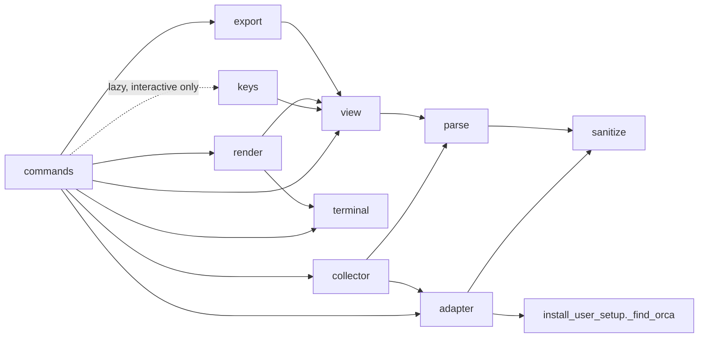
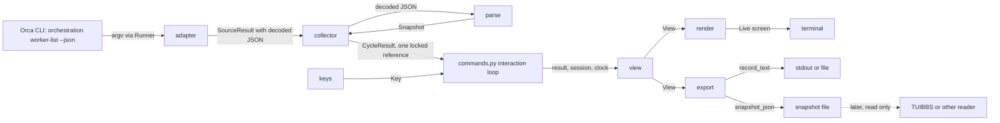

# Architecture Spine — orca-observer

## Design Paradigm

Pipes and filters, one direction only: **adapter** (the only Orca port) → **parse** → immutable **Snapshot** → pure **view** builder → two **renderers** (screen, export). The **collector** drives the pipe on a timer; the **interaction loop** owns session state and keys. All of it lives in the IronClaude subpackage `src/superclaude/cli/observe/`, one module per role.

| Layer | Module | Role |
| --- | --- | --- |
| Entry | `commands.py` | click group and options; wires the pieces; holds the interaction loop |
| Port | `adapter.py` | allow-listed argv, `Runner` and `Discover` seams, production runner, `LiveSource` |
| Filter | `parse.py` | JSON to `Snapshot`; `UNKNOWN` sentinel; pure `merge` owning the row set and `Coverage` |
| Filter | `sanitize.py` | untrusted text to printable literal text |
| Driver | `collector.py` | `Collector` over one `CycleSource`; single-flight bounded cycles; publishes `CycleResult` |
| Core | `view.py` | pure `build_view(result, session, clock) -> View`; `Session`, `Key`, pure `apply_cycle` and `apply_key`; every spec literal |
| Sink | `render.py` | screen renderer (Rich renderables) |
| Sink | `export.py` + `snapshot.schema.json` | text record and JSON snapshot from the same `View` |
| Policy | `terminal.py` | colour, ASCII, width class; builds every `Console` |
| Input | `keys.py` | key source behind one interface (spike outcome) |
| Data | `fixtures/` | redacted golden sample and the named fixture variants |

## Invariants & Rules

### AD-1 — One subpackage, one module per role, one dependency direction [ADOPTED]

- **Binds:** all
- **Prevents:** logic spread across `main.py`, renderers that call the adapter, and parse or sanitize rules duplicated per renderer.
- **Rule:** All observer code lives in `src/superclaude/cli/observe/` with the modules in the Design Paradigm table; tests live in `tests/observe/` mirroring it. Imports follow the diagram below and nothing else: no module imports `commands.py`; `view.py`, `render.py` and `export.py` never import `adapter.py` or `collector.py`; only `adapter.py` imports `subprocess`. `commands.py` imports `adapter.py` only to build the production `LiveSource` (production runner and discovery, AD-6). `keys.py` imports `view.py` only for the `Key` type. `keys.py` is imported lazily inside the interactive branch of `commands.py`, so no module on the `--once` import chain imports a POSIX-only module (`termios`, `tty`, `fcntl`).



### AD-2 — Registration is one deferred block in `cli/main.py` [ADOPTED form, CONDITIONAL timing]

- **Binds:** CAP-2, CAP-9; open owner decisions 3 and 4
- **Prevents:** a second registration mechanism (lazy group, entry point, plugin) and a live command shipped before the owner settles the production-integration boundary.
- **Rule:** The command is exposed only by one block placed before `if __name__ == "__main__":` in `src/superclaude/cli/main.py`: `from superclaude.cli.observe.commands import observe_group` with the house `# noqa: E402,I001` comment, then `main.add_command(observe_group, name="observe")`. The name string is the owner's (open decision 3). Under the stricter reading 1, which applies until the owner confirms otherwise, adding this block or running any live subprocess outside the fake runner is production integration that issue 409 does not authorize, so R0 work is fixture-only through tests and the block is not added. See CD-1.

### AD-3 — Binary discovery reuses `_find_orca()` once, outside the cycle cap [ADOPTED]

- **Binds:** CAP-2, CAP-4
- **Prevents:** a second Orca discovery routine and the GNOME screen reader `orca` being run as Orca.
- **Rule:** `adapter.py` declares `Discover = Callable[[], str | None]`, defaulting to `_find_orca` imported from `superclaude.cli.install_user_setup` as is, and `LiveSource` calls it once before the first cycle. It is the only place `skills list --json` runs (10 s timeout, not counted in the per-cycle subprocess cap). `None` publishes a `NOT_AVAILABLE` `CycleResult` (AD-20), which renders `worker-list NOT AVAILABLE (no Orca CLI validated)` (`adapter-contract.md:10`), and no cycle starts. Tests inject a fake `Discover` that appends the probe argv to the same argv log the fake runner uses, so T1 sees every argv the observer would run. Known limit: the probe runs inside `_find_orca`, outside the 8 MiB cap and the process-group kill of AD-5, until the helper is moved. Moving the helper is a separate owner-approved refactor.

### AD-4 — The adapter accepts one argv template and nothing else [ADOPTED]

- **Binds:** CAP-2, AC-1; T1, T2, T3, T36, T37
- **Prevents:** any write, consuming or operational Orca call from the observer, and argument injection through run ids or cursors.
- **Rule:** The only per-cycle argv is `[orca, "orchestration", "worker-list", "--json", "--limit", "100"]`, optionally followed by `"--run", runId` and `"--cursor", cursor`, built from a literal tuple in `adapter.py`. Values are separate argv items (never `--opt=value`), never start with `-`, `runId` passes a format check, and `cursor` is copied only from the previous `page.nextCursor` and byte-bounded. `--include-remote` is not in R1. A forbidden-prefix set (plain `check` without `--peek`/`--all`, `--ack`, `--wait`, `--retry-request`, `dispatch`, `inbox`, and every verb other than `worker-list` and the discovery probe) is checked before every call; entries are only ever added. Numeric bounds on the cursor and run id are PROPOSED.

### AD-5 — Subprocess execution goes through the house `Runner` seam [ADOPTED]

- **Binds:** CAP-2, CAP-4; T5, T36, T40
- **Prevents:** a second subprocess convention, a shell, a hung child holding the terminal, and unbounded output in memory.
- **Rule:** `adapter.py` declares `Runner = Callable[[list, float], tuple]` (`run(argv, timeout) -> (returncode, stdout)`), the shape used in `install_codegraph.py`. The production runner extends the `install_mcp._bounded` pattern (which uses `communicate()` and has no output cap): `Popen` with no shell, `stdin=DEVNULL`, `start_new_session=True`; stdout is read in chunks and the call is killed once 8 MiB is exceeded; stderr is drained on a separate thread into a 2 KiB buffer so a full pipe cannot block the child; on timeout or overflow the process group is killed (`os.killpg(SIGKILL)` on POSIX, `proc.kill()` elsewhere, PROPOSED) and reaped. stderr becomes a sanitized message, never logged raw. The per-call timeout is a named constant measured at the first permitted live read (R0 makes no Orca calls, `adapter-contract.md:28`); UNVERIFIED until then; T5 injects a configured value. Each read returns a `SourceResult` with a `state` of `OK`, `FAILED` or `PARTIAL` (`adapter-contract.md:7`; PARTIAL when paging stopped at the cap, or when a later page failed or the cycle budget ran out after earlier pages were read, the latter two PROPOSED), the decoded JSON of the pages read or none, and a `code` from one closed set: `exit:<n>`, `timeout`, `spawn-error` (an `OSError` when spawning the process, `adapter-contract.md:51`), `output-cap`, `json`, `shape`, `not-found`, `overrun` (`overrun` PROPOSED, AD-6). Labels: `FAILED (exit <n>)`, `FAILED (timeout)` and `FAILED (spawn error)` are spec; `FAILED (output cap)` is PROPOSED. Conflict recorded: `adapter-contract.md:14` says `subprocess.run`; `Popen` is used so a timeout kills the whole process group, which meets the same guarantees.

### AD-6 — One single-flight collector with fixed bounds [ADOPTED]

- **Binds:** CAP-2, CAP-4, AC-2, AC-3; T4, T5, T40, T45
- **Prevents:** overlapping polls, unbounded paging, wall-clock staleness errors, and a renderer reading a half-built snapshot.
- **Rule:** `collector.py` defines `Collector(source: CycleSource, clock)` with `start()` (one daemon thread waiting on a `threading.Event`, the `sprint/monitor.py` `OutputMonitor` shape), `latest() -> CycleResult` and `run_once() -> CycleResult` (one synchronous cycle, used by `--once` and by tests). `CycleSource` has two implementations: `LiveSource(runner, discover)` in `adapter.py` and `FixtureSource(variant)` in `collector.py`, reading `fixtures/` through the fixture loader; `commands.py` builds exactly one. Interval 15 s; the cycle budget equals the interval; cycles never overlap; at most 5 subprocesses per cycle (paging stops at the cap); each call's timeout is the smaller of the per-call timeout and the time left in the cycle budget, and when the budget runs out the running call is killed and reaped, paging stops, the cycle ends with code `overrun` (state PARTIAL, with coverage PARTIAL, if earlier pages were read, else FAILED; PROPOSED), and the strip shows `cycle overran (Ns)` (`adapter-contract.md:26`). After a failed cycle the next wait backs off and never exceeds 60 s (doubling from 15 s is PROPOSED). Polling is unbound by default: `--run` is added only when the user binds a Run with an observer option. The collector does not decide `one Run only`: `view.py` adds it whenever the parsed `result.scope.source` is `bound`, whatever the observer's options (`adapter-contract.md:63`); `flag` and `all` show only `scope=<source>`, and an absent scope reads `scope unknown`. R1 does not rotate Runs: it has one verb and at most one `--run`, and the rotation set starts in R2 (`adapter-contract.md:56`). For `read k of N Runs since start; oldest among Runs read` (`rendering-rules.md:17`, added until every Run in the rotation set has been read once; R1 has no rotation set, so in R1 it is never removed) the collector keeps `runs_read`, the set of distinct `runId` source values in rows returned by successful cycles since this observer process started. It is never reset while the process runs; a restart starts it empty, which `since start` discloses. k is its size. A row whose `runId` is `UNKNOWN` is not added to the set, because it may belong to a Run not yet counted, so the collector also keeps `runs_unknown_rows`, the number of distinct row identities (AD-7) with an `UNKNOWN` `runId` seen in successful cycles since start; while that count j is above 0, k is only a lower bound and renders in the AD-8 aggregate form `n+? (k unknown)` as `k+? (j unknown)` (`rendering-rules.md:50`, T38: unknown is never zero). No R1 source lists every Run, so N is `UNKNOWN` in R1 and the token renders `read k of unknown Runs since start; oldest among Runs read` when j is 0 and `read k+? (j unknown) of unknown Runs since start; oldest among Runs read` when j is above 0 (`unknown` for N is PROPOSED wording, AD-8); with rows on screen and no `runId` on any of them it reads `read 0+? (j unknown) of unknown Runs since start; oldest among Runs read`, never a bare 0. From R2, N is the size of the rotation set. Which headers carry the token is CD-10. The collector reads time only from the injected clock and computes no staleness: it records `last_success_mono` and `last_success_wall`, and `view.py` derives STALE and ages (AD-20). Each cycle publishes one immutable `CycleResult` (AD-20) by replacing one reference under a lock; consumers only read that reference. Caps are per process; there is no cross-process singleton (CD-11). No LLM is called anywhere in the loop.

### AD-7 — Parsing is strict on the envelope and lenient inside rows [ADOPTED]

- **Binds:** CAP-2, CAP-4, CAP-5; T22, T32, T39
- **Prevents:** a missing inner field crashing the screen, a broken envelope silently replacing good data, and two Orcas' rows merging.
- **Rule:** `parse.py` requires `result` to be an object, `result.workers` a list and `result.page.hasMore` a bool; if any is missing or of another type the cycle is `FAILED (shape)` and the last good `Snapshot` stays. A row that is not an object is counted as malformed and skipped. `result.scope` and `page.total` are optional; a `page.total` that is not a non-negative integer becomes `UNKNOWN`. Any other key that is missing or whose value is JSON null becomes the single `UNKNOWN` sentinel object defined in `parse.py` (never `None`, `0`, `""` or `False`); unexpected keys are counted per row and per cycle, their names and values are not shown, and the inspector shows the row's count as `n unrecognised keys` (`adapter-contract.md:38`). Row identity is `(source.namespace, dispatchId)`. A row whose `dispatchId` is `UNKNOWN` instead gets a per-cycle identity `(source.namespace, UNKNOWN, cycle, source_rank)`: it is never deduplicated or matched across cycles, it is counted separately, and the next cycle that is not PARTIAL replaces the previous cycle's such rows while a PARTIAL cycle keeps them (AD-8) (PROPOSED). `source.namespace` is not an Orca field: it is derived by the observer (observer-derived, PROPOSED: the resolved absolute path of the Orca CLI that `_find_orca()` validated, constant for an observer process in R1; R4 extends it with `projection.host.id` before remote rows are admitted, `adapter-contract.md:43`), set by `LiveSource` or by the fixture, and T39 uses two fake sources with different resolved paths. Duplicates, ordering flags and the row set across cycles are owned by `parse.merge` (AD-19). Only verified worker-list keys are read; fixture-only fields are loaded by a separate fixture loader, never by the live parser.

### AD-8 — Unknown is never zero, and source loss never lowers a count [ADOPTED]

- **Binds:** CAP-3, CAP-4, CAP-5, AC-4, AC-5, AC-6; T9, T11, T12, T13, T14, T15, T18, T31, T33, T34, T38, T42, T47
- **Prevents:** a degraded source reading as a healthy empty fleet, released rows reading as done, and paging limits reading as totals.
- **Rule:** Every value that reaches a renderer is either a source value or `UNKNOWN`, rendered `unknown`; aggregates with unknown members render `n+? (k unknown)`. Sources with no feed render `unavailable (no source)`; cost renders `cost unavailable`; `terminalState=released` never renders `done`, `complete` or `settled`. Freshness is per source: `worker-list OK 4s` / `STALE 52s` / `FAILED (exit 2) 1m` / `NOT POLLED`, with last good values shown `as of HH:MM:SS`. Coverage and list literals render the spec strings exactly, all defined once in `view.py` (AD-10): `PARTIAL: collected n of reported T (newest first; oldest rows not read; long-running active workers may be among them)`, `collected n / reported T (mismatch)`, `PARTIAL (empty page k)`, `reported unknown` when `page.total` is absent, `reported T (page k)`, `reported T1-T2 (changed during read)`, `filter <expr>: k of n collected`, `x/y shown`, `+N more`, `k historical hidden (h)`, the footer `shown x/y | collected n / reported T`, `messages UNVERIFIED (not read)`, `n unrecognised keys` (inspector), `one Run only` and `read k of N Runs since start; oldest among Runs read`, with k in the aggregate form `k+? (j unknown)` whenever rows with an `UNKNOWN` `runId` were seen (AD-6). Header literals (`scope=<source>`, `scope unknown`, `one Run only`, the Runs-read token) go in the header; status-line literals (freshness, coverage, `selected <id> no longer in source window`) go on the strips; row literals (`unknown`, `not reobserved`, `order unknown`, `conflict (time went back)`, `*`) go in the row. A failed, stale or partial cycle never removes a row, closes a question or lowers an open count; a row that drops out stays, marked `not reobserved`. The question area reads `Human questions: source UNVERIFIED, 0 rows interpreted, not "no questions"` until QUESTION-OBSERVATION passes. Poll age and evidence age (`evidence.lastObservedAt`) are shown separately.

### AD-9 — All worker text passes one sanitizer and renders literally [ADOPTED]

- **Binds:** CAP-8, AC-10; T29, T30, T44
- **Prevents:** escape-sequence injection, Rich markup interpretation, and wide characters split or overflowing.
- **Rule:** `sanitize.py` is the only sanitizer. `parse.py` applies it to every string from the source before it enters a `Snapshot`, so no renderer sees raw text. It keeps printable characters only: it strips CSI and OSC (terminated or not), C1 (including 8-bit `\x9b`), C0 and Unicode Cf (bidi controls included). It has two modes: line mode, used for every field, replaces each newline with a space; block mode keeps newlines and is used only for `stage.detail`, `stage.activity` and the stderr diagnostic, which only the inspector shows. A test puts `\n` inside a `dispatchId` and asserts the text record still has one line per row. Renderers build `rich.text.Text` objects from data, never markup strings (`markup=False` wherever a string is printed). Truncation measures `rich.cells.cell_len`, never splits a double-width character, is done by one helper in `terminal.py`, and is used only by the screen renderer. `adapter.py` passes stderr through the same sanitizer.

### AD-10 — One pure view model feeds every output [ADOPTED]

- **Binds:** CAP-2, CAP-4, CAP-5, CAP-6, CAP-7, CAP-9, CAP-10; T6, T20, T21, T48
- **Prevents:** the screen and the exports disagreeing, and non-deterministic output.
- **Rule:** `view.py` defines `build_view(result, session, clock) -> View`, a pure function: no I/O, no global state, no time read except through the injected clock. `View` is a frozen dataclass tree of display-ready values: full untruncated identifiers, every frozen snapshot field, the freshness and coverage block, counts with denominators, change flags and the historical-hidden count. It carries two row tuples: `all_rows`, every row in the merged `Snapshot`, independent of the `Session`, in the AD-12 order; and `visible_rows`, after the session's filter and historical toggle, in source order (`source_rank` from AD-19, the ledger's newest-first order). `view.py` owns both orders; no renderer or export sorts. `view.py` also owns every spec status literal as the final text of each status line and cell, and is the only module that turns `UNKNOWN` into a screen word (`unknown`, `scope unknown`, `reported unknown`, `unknown (absent in source)` in the inspector); it re-exports `UNKNOWN` so `export.py` never imports `parse.py`. Renderers only lay out and truncate. `view.py` derives the source state and ages (AD-20). It also defines the `Key` type (named keys plus `Text(char)`). `View.questions` is built only from `CycleResult.fixture_questions` (AD-20), oldest first with requester, owner and affected IDs (T7); in live mode it is `None` and the question area shows the UNVERIFIED notice (AD-8). Snapshot v1 has no question field, so these rows are never exported in R1 (stage B adds the optional `questions` group, AD-18). Width, colour and glyph choices are not in the `View`. The same inputs give a byte-identical render. Sessions sharing one `worktreeId` stay separate rows; T20 (`acceptance-tests.md:29`) asserts the shared `resource.worktreeId` in each row's inspector, which reads `unknown (absent in source)` when it is absent; whether the ledger row names it is open owner question UX-OQ-8 (CD-16); no count divides one by the other, and no `conflict` label appears for the shared worktree.

### AD-11 — Two renderers read the `View`; export never reads the screen [ADOPTED]

- **Binds:** CAP-8, CAP-9, CAP-10, AC-9; T23, T24, T27, T48
- **Prevents:** an export that inherits screen truncation or colour, and a third ad hoc output path.
- **Rule:** `render.py` turns a `View` plus a `TerminalPolicy` into Rich renderables for the screen. `export.py` turns the same `View` into two serializations: `record_text(view) -> str` (the `e` key and `--once`: no ESC byte, full identifiers, no truncation) and `snapshot_json(view) -> str` (AD-12). Both read only `view.all_rows` and the session-independent blocks, so the export is lossless whatever the filter; `record_text` names the active filter and toggle in its header (PROPOSED: the spec does not say whether an export follows the filter). A test builds one `CycleResult` with two different sessions and asserts byte-identical `snapshot_json`. Neither export function imports `render.py` or reads its output, and neither goes through a Rich `Console`: `--once` writes `record_text` with `sys.stdout.write` after `commands.py` encodes it with the encoding from `terminal.output_encoding()` and `errors="replace"`; a file write goes through one helper in `export.py` that writes a temporary file in the same directory and `os.replace`s it; the destination comes from CD-6: the snapshot path is set by a PROPOSED `--snapshot PATH` option whose default is the per-user state directory `~/.local/state/superclaude/observe/` (CD-6); the file is created with owner-only permissions (0600) and replaced atomically each live cycle; the destination remains open owner question UX-OQ-4. `--once` needs no raw mode on any platform.

### AD-12 — Snapshot v1 is frozen, versioned and additive-only [ADOPTED]

- **Binds:** CAP-10; recorded owner decision 2; the snapshot schema test
- **Prevents:** a later Go reader breaking on a renamed field, invented Orca fields, and sensitive data leaving the observer.
- **Rule:** `snapshot_json` emits, per cycle, exactly the fields of `snapshot-export-schema.md`. Envelope: `schemaVersion` (integer `1`), `producer` (observer name and package version), `cycle`, `generatedAt` (UTC ISO 8601), `source.namespace`, `source.status` (`OK`, `STALE`, `ERROR`, `UNKNOWN`, mapped from the AD-20 source state: FAILED to `ERROR`, NOT_POLLED and NOT_AVAILABLE to `UNKNOWN`), `source.observedAt`, `source.error` (the AD-5 code, no raw stderr), `page.hasMore`, `page.total`, `page.limit`, `scope` (always emitted: the source object passed through, or the string `UNKNOWN` when absent), `counts` (passed through as a map, never summed), the optional observer-derived `collection.state`, `collection.collected`, `collection.changedDuringRead` and `collection.duplicatesIgnored` (`snapshot-export-schema.md:41-44`), and `rows`. A dotted name such as `source.status` or `stage.worker` is a nested JSON object, not a key containing a dot; any source-derived field may hold its source type or the string `UNKNOWN`, and the schema declares each as that union; the optional observer-derived fields have fixed types. Rows: `dispatchId`, `taskId`, `runId`, `workerState`, `dispatchStatus`, `terminalState`, `role`, `provider`, `hostKind`, `hostId`, `stage.worker`, `stage.dispatch`, `outcome`, `liveness.verdict`, `liveness.observedAt`, `liveness.source`, `evidence.durable`, `evidence.liveStatus`, `evidence.lastObservedAt` (the evidence timestamp), `nextAction` (raw `nextAction.kind`), and the optional observer flags `orderUnknown`, `notReobserved` and `absentFields` (`snapshot-export-schema.md:66-68`). Rows are `view.all_rows`, ordered by `liveness.observedAt`, else `evidence.lastObservedAt`, newest first, ties by `dispatchId` (which order is authoritative for consumers is CONDITIONAL, CD-3). A missing value is the string `UNKNOWN`; only `export.py` maps the sentinel to it. The optional `absentFields` row list separates a missing value from a source string `UNKNOWN` (`snapshot-export-schema.md:68`). Not emitted in v1: `stage.detail`, `stage.activity` (CD-2), terminal handles, worktree and endpoint ids, ownership and release state, `warnings`, `page.nextCursor`, message bodies, prompts, file contents, credentials. The schema is `observe/snapshot.schema.json`, checked with `Draft7Validator.check_schema` at import; the producer schema sets `additionalProperties: false` so any new field needs a reviewed schema edit, which may only add optional fields; removing, renaming or retyping a field requires `schemaVersion` 2. Consumers reject an unknown major and ignore unknown fields. Output uses `json.dumps(indent=2, sort_keys=True)`. The schema is PROPOSED, not an Orca contract.

### AD-13 — `terminal.py` alone owns colour, ASCII and width [ADOPTED]

- **Binds:** CAP-8, AC-9; T16, T23, T26, T28, T35, T43, T49
- **Prevents:** each renderer deciding colour or width differently, and colour carrying meaning on its own.
- **Rule:** `terminal.py` exposes `resolve_policy(env, encoding, flags, width, height) -> TerminalPolicy`, `output_encoding() -> str` and `make_console(policy, file=None, record=False) -> Console`; no other module constructs a `Console` or reads `NO_COLOR`, `COLUMNS` or the stream encoding. Every console gets `highlight=False`, `markup=False` and an explicit `width`. `no_color` is true when `NO_COLOR` is set and non-empty (including `1` and `yes`) and is passed explicitly as `color_system=None`, `no_color=True`. `ascii` is true with `--ascii`; turning it on automatically for a non-UTF-8 output encoding is PROPOSED. ASCII mode uses `box.ASCII`, `safe_box=True`, and glyphs mapped by one table (`·` to `.`; `▸` to `@` and other non-ASCII to `?` are PROPOSED). Tables use `overflow="crop"` after the truncation helper has run. Width classes: 160 and wider full table; 116 to 159 line form; 80 to 115 short form; below 80 `terminal too narrow (min 80)` above the COUNTS strip, whose denominators still print, with the gap notice kept (`rendering-rules.md:12`, `:31`) and the ledger in its short form at the reduced width (`EXPERIENCE.md:108`). Every screen line has `cell_len <= width`. Styles come from one palette table in `terminal.py` (CD-8); blink, faint, italic and underline are never used and the background is never painted. Meaning is always carried by words, so a no-colour render loses nothing. Height handling and drop order follow CD-4.

### AD-14 — Key input sits behind one `KeySource`; the spike decides Rich or Textual, never both [ADOPTED]

- **Binds:** CAP-1, CAP-6, CAP-8; recorded owner decision 2
- **Prevents:** a terminal left in raw mode, two UI toolkits in one package, and a toolkit switch rewriting the core.
- **Rule:** `keys.py` defines `KeySource` with a context manager that enters cbreak mode through `tty.setcbreak(fd, termios.TCSANOW)` and restores the saved attributes in `finally` and from SIGINT and SIGTERM handlers (a SIGINT restores the terminal, then re-raises `KeyboardInterrupt` so the loop quits), and `read(timeout) -> Key or None` (timeout at most 250 ms) that decodes escape sequences into the `Key` type from `view.py`. The R0 spike is this module plus a `pexpect` pty test (pexpect is already a dependency). Spike pass criteria, PROPOSED until the owner settles them (CD-7): lone Esc told apart from arrow sequences; no key lost during a redraw; selection stays on the same identity; terminal restored on `q`, Ctrl-C, SIGTERM and an exception; a resize redraws within one cycle; no visible flicker. Pass: the interactive screen is `rich.live.Live(screen=True)` with a console from `make_console`, redrawn on a new `CycleResult` or a key. Fail: `textual` (8.2.8, which needs `rich>=14.2.0`, so the rich floor rises with it) is added as a dependency, `keys.py` and the `Live` loop are deleted, and a Textual app renders the same `View` through `render.py`; `adapter`, `collector`, `parse`, `sanitize`, `view` and `export` do not change. The two paths never coexist. Conflict recorded: `sprint/tui.py` uses `screen=False`; the observer uses `screen=True` so it owns the alternate screen while in cbreak mode. Interactive mode is POSIX only: on other platforms `commands.py` prints `interactive mode needs a POSIX terminal; use --once` (PROPOSED wording) and exits non-zero without importing `keys.py`; `--once` covers every platform, and a test imports `commands.py` with `termios` blocked.

### AD-15 — Keys change session state only; selection is anchored to identity [ADOPTED]

- **Binds:** CAP-6, CAP-7, AC-1, AC-4; T3, T8, T10, T25, T41, T45
- **Prevents:** a key reaching Orca, a refresh moving the cursor, and marking as seen closing anything.
- **Rule:** `view.py` defines `Session` (focus mode `list`, `inspector` or `filter`; selected identity and the last-known values of that row; filter text; show-historical flag; `baseline: Mapping[Identity, tuple]` holding the four change-flag raw values per row, or none before the first observation; `mark_wall_time`; default view fixed at start-up). Two pure functions change it, and nothing else does: `apply_cycle(session, result, clock) -> Session`, called by the loop on each new `CycleResult`, sets the baseline from the first successful observation (no change flags then) and refreshes the selected row's last-known values; and `apply_key(session, key, view, clock) -> (Session, Effect)`, where `Effect` is `NONE`, `EXPORT` or `QUIT` and the loop performs the effect. Neither calls the adapter or collector. Keys: Up, Down, `j`, `k`, Enter, Esc, `/`, `h`, `m`, `e`, `q`, Backspace; Ctrl-C quits; unknown keys do nothing; in filter mode letters are text. A refresh never changes focus or selection; a selected row that disappears stays selected from its last-known values, is marked `not reobserved`, and the screen reports `selected <id> no longer in source window`. A row is flagged `*` when it was added, removed, or its `stage.worker`, `stage.dispatch`, `nextAction.kind` or `liveness.verdict` differs from the baseline (which stage subfield drives this is CONDITIONAL, CD-2); all three kinds count in `changed since HH:MM (k)`, where `HH:MM` is `mark_wall_time` (the first observation's time until `m` is pressed). `m` replaces the baseline with the current rows, sets `mark_wall_time` from the clock, and never lowers an open count. The baseline is never persisted, and the header discloses that a restart took a new baseline (`rendering-rules.md:46`; the exact words are PROPOSED: `new baseline at HH:MM (observer started)`).

### AD-16 — Tests run headless against fixed seams [ADOPTED]

- **Binds:** all; T1 to T51 and the snapshot schema test
- **Prevents:** tests that need a TTY or a live Orca, and a test that passes because a real subprocess ran.
- **Rule:** Every test injects the adapter's `Runner` with a fake that returns recorded JSON and raises on any argv outside AD-4, and injects a fake `Discover` (AD-3); both write to one argv log that T1 checks. R0 replays the synthetic `base` variant because no recorded `worker-list` sample exists (`release-gates.md:9`, gate: none from Orca, offline only); the redacted golden samples of the four kinds are recorded at the first permitted live read and, with a passing T32, belong to the R1 gate (`release-gates.md:11`); CD-9 covers only message samples. `subprocess.Popen` and `subprocess.run` are patched to raise in the observer test package (T36). Time comes from an injected fake clock for monotonic time, wall time and the local time zone. Screens render through `make_console(policy, file=StringIO(), record=True)` at a fixed width (160, 116, 80), read back with `export_text()`. Fixture variants are `base`, `uneven`, `shared-unmapped`, `historical`, `long-identifiers`, `source-loss`, `missing-fields`, `duplicate-out-of-order`, `empty`, `injection`. R0 replay runs as render tests through `FixtureSource` under `uv run pytest tests/observe`; every fixture-mode `View` carries `mode=fixture` and the variant, and the header reads `SYNTHETIC FIXTURE <variant>, not Orca data` (`rendering-rules.md:17`, spec-fixed). Separately, every R0 render of A, B and C carries the T50 marking `synthetic fixture, not live evidence` (`rendering-rules.md:5`, `acceptance-tests.md:44`); T50 asserts that marking. The `missing-fields` variant includes a row with no `dispatchId` (asserted to keep a per-cycle identity and never merge, AD-7) and a field whose value is JSON null (asserted to render `unknown`). Fixture-only question rows (T7) travel one path: `fixtures/` to the fixture loader (which passes every fixture string through `sanitize.py`) to `FixtureSource` to `CycleResult.fixture_questions` to `View.questions` to the screen renderer (AD-20, AD-10), never through the live parser. `test_view` builds a `CycleResult` with `scope.source=bound` and no observer `--run` and asserts the header shows `one Run only`; `test_collector` asserts `runs_read` grows only on successful cycles and never adds an `UNKNOWN` `runId`, and that `runs_unknown_rows` counts the rows that carry one; `test_view` asserts the token renders `read k of unknown Runs since start; oldest among Runs read` only when that count is 0, and `read k+? (j unknown) of unknown Runs since start; oldest among Runs read` otherwise, including the `missing-fields` variant (T13) where no row has a `runId` and the header must not read a bare `read 0`. The R2 placeholder tests (T19, T51) are skipped with a marker registered in `pyproject.toml`; the repo's `--strict-markers` in `addopts` was silently ignored by pytest 9.0.x (fixed in 9.1.0), so the marker check is not relied on under 9.0.x. Only the key-reader spike test uses a real pty. Tests map to decisions as follows: `test_adapter` AD-3 to AD-5; `test_collector` AD-6, AD-20; `test_parse` AD-7, AD-19; `test_sanitize` AD-9; `test_view` AD-8, AD-10, AD-15; `test_render` AD-11, AD-13; `test_export` and `test_snapshot_schema` AD-11, AD-12; `test_terminal` AD-13; `test_keys_spike` AD-14; `test_commands` AD-1, AD-2, AD-14 (import with `termios` blocked).

### AD-17 — R1 contains no write path, no TUIBBS code and no controls [ADOPTED]

- **Binds:** all; recorded owner decisions 3 and 4; AC-1
- **Prevents:** scope creep into an operator console, licence contamination, and a read-only claim that code contradicts.
- **Rule:** R1 has no approve, retry, terminate, spawn, merge, instruct or acknowledge action, no write-back to Orca, agents or TUIBBS, no message reads, no `--include-remote`, no LLM call, and no code, import or vendored file from TUIBBS or the design prototype (`canvas.py` is never imported). Write-back needs an issue 409 boundary change and a TUIBBS FR-X-13 amendment first and gets no hook in R1.

### AD-18 — Later stages extend by adding sources, field groups and modules, never by editing R1 contracts [ADOPTED]

- **Binds:** CAP-11, CAP-12; R2, R3, R4 gates
- **Prevents:** stage B or C rewriting the adapter or breaking snapshot v1, and the Go reader coupling to Python internals.
- **Rule:** Stage B (after QUESTION-OBSERVATION, sample and acquisition permission, CD-9) adds the candidate message verb from `release-gates.md` to `adapter.py` as one more literal template (the only place `check` may appear, with `--peek`/`--all` and never with `--ack`, `--wait` or `--retry-request`), proven non-consuming by T51 first, its own freshness cell (shown as `messages UNVERIFIED (not read)` until then), a `questions.py` retention store bounded at 1,000 records whose eviction never lowers the open total, and an optional `questions` field group in the snapshot. Stage C (after QUESTION-LINK) adds a `links.py` module and an optional field group. R4 adds `--include-remote` to the allow-list. A TUIBBS or other reader consumes only the snapshot file under AD-12 and shares no code; a licence opinion comes first. Each extension adds forbidden-prefix entries if needed and never removes one.

### AD-19 — One pure merge owns the row set across pages and cycles [ADOPTED]

- **Binds:** CAP-2, CAP-4, CAP-5, AC-6, AC-8; T11, T12, T22, T33, T38, T39, T42
- **Prevents:** rows vanishing when a later page or cycle drops them, two places deciding duplicates, and coverage counted differently by screen and snapshot.
- **Rule:** `parse.py` defines `merge(previous: Snapshot | None, pages, stopped_by_cap, stopped_by_error, clock) -> (Snapshot, Coverage)`, a pure function called only by the collector after a cycle that read at least one page; a cycle that fails on its first page never calls it, so the previous `Snapshot` stays. When page k>1 fails or the budget runs out (AD-6), merge is called with the pages read and `stopped_by_error` set to the AD-5 code, coverage reads PARTIAL with that code, and unread rows stay `not reobserved` (PROPOSED). Within and across cycles a row is keyed by identity (AD-7); when two copies meet, the newer `liveness.observedAt` (else `evidence.lastObservedAt`) wins; when either timestamp is absent the newer cycle wins and the row is flagged `order unknown` (`adapter-contract.md:44`); the duplicate is counted (`k duplicate rows ignored`). A row in `previous` that this cycle did not return stays, with `reobserved=False` and its `last_seen_cycle`. Each row carries `source_rank` (its position in this cycle's newest-first pages), `order_flag` (`order unknown` with no timestamp, `conflict (time went back)` when a timestamp moved backward) and its unrecognised-key count. `Coverage` holds the per-page `total`, the index of any empty page, `has_more_at_stop`, the duplicate count and whether `total` changed during the read. A cap on rows retained across cycles is PROPOSED and, when reached, is shown, never silently applied.

### AD-20 — Every cycle publishes a `CycleResult`; `view.py` alone derives source state [ADOPTED]

- **Binds:** CAP-4, CAP-9, CAP-10, AC-2, AC-5; T4, T5, T9, T11, T40
- **Prevents:** a screen with nothing to show before the first poll, two modules deciding STALE, and a snapshot written twice or skipped for one cycle.
- **Rule:** The collector publishes a `CycleResult` before the first poll (`NOT_POLLED`), when discovery returns `None` (`NOT_AVAILABLE`), and after every cycle. A `CycleResult` holds the cycle number, `mode` (`fixture` or `live`) and fixture variant, the last `SourceResult` code, the current merged `Snapshot` and `Coverage`, `last_success_mono` and `last_success_wall`, `runs_read` and `runs_unknown_rows` (AD-6), and no STALE flag. In fixture mode it also carries `fixture_questions`, a tuple of `FixtureQuestion` records that `FixtureSource` loads for the variant (PROPOSED fixture-only shape: asked time, requester, owner, affected dispatch IDs and text; not an Orca field, since message row fields are UNVERIFIED); in live mode it is `None`, because R1 reads no message source. `view.py` derives one source state with this precedence: `NOT_AVAILABLE` > `NOT_POLLED` > `FAILED` > `STALE` > `OK` (FAILED above STALE is PROPOSED, read from the spec example `FAILED (exit 2) 1m`). Poll age and STALE come from `clock.monotonic()` minus `last_success_mono`; evidence age from `clock.wall()` minus `evidence.lastObservedAt`. In live mode the interaction loop keeps `last_written_cycle` and, when it sees a higher cycle number, writes exactly one snapshot for that cycle, after failures as well as successes, to the CD-6 destination: the snapshot path is set by a PROPOSED `--snapshot PATH` option whose default is the per-user state directory `~/.local/state/superclaude/observe/` (CD-6); the file is created with owner-only permissions (0600) and replaced atomically each live cycle; the destination remains open owner question UX-OQ-4.

## Consistency Conventions

| Concern | Convention |
| --- | --- |
| Naming | Modules and functions `snake_case`; types `PascalCase` (`Snapshot`, `Coverage`, `CycleResult`, `SourceResult`, `Collector`, `CycleSource`, `View`, `Session`, `Key`, `Effect`, `TerminalPolicy`, `KeySource`); constants `UPPER_SNAKE` in the module that owns them (interval, caps and timeouts in `collector.py` and `adapter.py`). Snapshot JSON keys keep the Orca source spelling (`camelCase`). |
| Identity | A row is `(source.namespace, dispatchId)` everywhere: parse, view, selection, change flags and snapshot ordering ties. No position-based identity, except the per-cycle identity AD-7 gives a row whose `dispatchId` is `UNKNOWN`. |
| Missing data | In memory the single `UNKNOWN` sentinel from `parse.py`, re-exported by `view.py`; `view.py` alone turns it into screen and text-record words (`unknown` and the place-specific forms); `export.py` alone turns it into the snapshot string `UNKNOWN`. Never `None`, `0`, `""` or `False` for a missing source value. |
| Time | One injected clock object provides `monotonic()`, `wall()` and the local time zone; no module calls `time` or `datetime` directly. Staleness, poll ages and backoff use `monotonic()`; evidence age uses `wall()`; displayed wall times are local `HH:MM:SS`; serialized times are UTC ISO 8601. |
| State | `Snapshot`, `Coverage`, `CycleResult`, `SourceResult`, `View` and `Session` are frozen dataclasses; `Session` changes only through `apply_cycle` and `apply_key` (AD-15), the row set only through `parse.merge` (AD-19); a change makes a new object. The only shared mutable thing is the collector's published reference, swapped under one lock. |
| Errors | Adapter and parse failures become a `SourceResult` status plus a short sanitized code; they never raise into the render loop. A render exception stops the screen, restores the terminal and exits non-zero; it never retries silently (conflict recorded: `sprint/tui.py` logs and continues). Raw stdout and stderr are never logged. |
| Output text | Every user-facing status string is a literal copied from the spec (or marked PROPOSED) and defined once in `view.py`, which puts the final text into the `View`; renderers only lay it out and truncate; tests assert the literal. |
| Package data | `snapshot.schema.json` and `fixtures/` live inside the package (hatchling `packages = ["src/superclaude"]` ships non-Python files) and are loaded with `importlib.resources`. |
| Tooling | Commands run through `uv run`; tests through `uv run pytest tests/observe`; lint with the repo's pinned `ruff`. New pytest markers are registered in `pyproject.toml`. |

## Stack

| Name | Version |
| --- | --- |
| Python | >=3.10 (repo floor; 3.10 reached end of life 2026-10-01; floor unchanged by this feature) |
| rich | 15.0.0 verified latest on 2026-11-08; repo floor >=13.0.0 kept |
| click | 8.5.1 verified latest on 2026-11-08; repo floor >=8.0.0 kept |
| jsonschema | 4.26.0 verified latest on 2026-11-08; repo floor >=4.0.0 kept (Draft7Validator) |
| pexpect | >=4.9 (repo floor, already a dependency; spike test only) |
| pytest | 9.2.0 verified latest on 2026-11-08; repo floor >=7.0.0 kept |
| textual | 8.2.8 verified latest on 2026-11-08; added only if the key-reader spike fails (AD-14) |
| Python stdlib | `termios`, `tty`, `select`, `signal`, `subprocess`, `threading`, `importlib.resources` (same Python version) |

## Structural Seed



Operational envelope (per observer process): poll interval 15 s; cycle budget 15 s; at most 5 subprocesses per cycle; 8 MiB stdout per call; stderr kept to 2 KiB sanitized; STALE at 45 s without a successful read; failure backoff never above 60 s; discovery once at start (10 s timeout, outside the cap); in live mode one snapshot write per published cycle to the CD-6 destination; no cross-process coordination.

```text
src/superclaude/cli/observe/
  __init__.py
  commands.py            click group, options, interaction loop
  adapter.py             allow-list, Runner and Discover seams, production runner, LiveSource
  collector.py           Collector, CycleSource, FixtureSource, CycleResult publication
  parse.py               Snapshot, Coverage, UNKNOWN, merge, fixture loader
  sanitize.py            literal-text sanitizer (line and block modes)
  view.py                View, Session, Key, Effect, build_view, apply_cycle, apply_key, spec literals
  render.py              screen layouts per direction (Signal Bridge, Attention Ledger, Decision Desk)
  export.py              record_text, snapshot_json, atomic file write
  snapshot.schema.json   snapshot v1 JSON Schema
  terminal.py            TerminalPolicy, make_console, palette, glyph table, cell truncation
  keys.py                KeySource (removed if the spike fails)
  fixtures/              synthetic fixture variants and the redacted golden worker-list sample
tests/observe/
  conftest.py            fake Runner, fake clock, subprocess guard, console factory
  test_adapter.py
  test_collector.py
  test_parse.py
  test_sanitize.py
  test_view.py
  test_render.py
  test_export.py
  test_snapshot_schema.py
  test_terminal.py
  test_commands.py       import with termios blocked, --once path
  test_keys_spike.py     the only real pty test
```

## Capability → Architecture Map

| Capability/Area | Lives in | Governed by |
| --- | --- | --- |
| CAP-1 R0 fixture replay of A, B, C at 160/116/80, spike result | `fixtures/`, `parse.py` fixture loader, `render.py`, `keys.py`, `tests/observe/` | AD-7, AD-10, AD-13, AD-14, AD-16; CD-1, CD-7, CD-14 |
| CAP-2 R1 worker ledger from `worker-list` | `adapter.py`, `collector.py`, `parse.py`, `view.py`, `render.py` | AD-2 to AD-7, AD-10, AD-19; CD-1, CD-14 |
| CAP-3 question-source gap notice | `view.py`, `render.py` | AD-8 |
| CAP-4 completeness and freshness | `collector.py`, `parse.py`, `view.py` | AD-6, AD-7, AD-8, AD-10, AD-19, AD-20; CD-10 |
| CAP-5 separate facts, nothing inferred | `parse.py`, `view.py` | AD-7, AD-8, AD-19 |
| CAP-6 identity-anchored selection and inspector | `view.py`, `render.py` | AD-10, AD-15; CD-16 |
| CAP-7 changes since last look | `view.py` | AD-15; CD-2 |
| CAP-8 literal text, widths, NO_COLOR, ASCII | `sanitize.py`, `terminal.py`, `render.py` | AD-9, AD-13; CD-4, CD-5, CD-8 |
| CAP-9 text record export | `export.py`, `commands.py` | AD-10, AD-11, AD-20; CD-6 |
| CAP-10 JSON snapshot v1 | `export.py`, `snapshot.schema.json` | AD-12, AD-20; CD-2, CD-3, CD-6 |
| CAP-11 R2 retained questions | later `questions.py`, adapter template, snapshot field group | AD-18; CD-9, CD-14 |
| CAP-12 R3 Decision Desk | later `links.py`, snapshot field group | AD-18 |
| Read-only boundary and exclusions | `adapter.py`, whole package | AD-4, AD-17; CD-13 |
| Later Go or TUIBBS reader | snapshot file only | AD-12, AD-18; CD-12 |

## Conditional Decisions

Each row depends on an open owner question. The default holds until the owner answers; nothing here resolves the question.

| ID | Architecture decision | Depends on | Default until decided | What changes when decided |
| --- | --- | --- | --- | --- |
| CD-1 | Whether the `main.py` registration block lands and live subprocesses may run outside the fake runner | OQ-2 production-integration reading; OQ-3 command name | Reading 1: no registration block, no live call; R0 runs only through tests and fixtures; recommended name `observe` | Reading 2: AD-2 block is added with the owner's name and R1 live reads start, still subject to CD-9 and CD-14 |
| CD-2 | Change-detection fields and whether `stage.detail` and `stage.activity` enter the snapshot | OQ-15 | Change flags use `stage.worker`, `stage.dispatch`, `nextAction.kind`, `liveness.verdict`; detail and activity are inspector-only and not emitted | AD-15 flag fields are replaced; if allowed, the two fields are added to snapshot v1 as optional fields (additive, no version change) |
| CD-3 | Authoritative snapshot row order | OQ-12 | Timestamp order in AD-12 | If source order wins, the snapshot keeps source order and the sort moves to the screen only; the schema does not change |
| CD-4 | Height budget, minimum rows and drop order; A width matrix and B, C coordinates | OQ-14; UX-OQ-2 | Only spec-fixed rules: COUNTS never dropped; coverage, scope and PARTIAL are minimum content; T49 diagnostic when too small | The numbers and drop order go into one table in `terminal.py` read by `render.py` |
| CD-5 | Truncation glyph | UX-OQ-5 | `>` (spec rule and T24) | Only the glyph table in `terminal.py` changes |
| CD-6 | Export and snapshot destinations, file naming and messages | UX-OQ-4 | `--once` prints `record_text` to stdout. The snapshot path is set by a PROPOSED `--snapshot PATH` option whose default is the per-user state directory `~/.local/state/superclaude/observe/` (CD-6); the file is created with owner-only permissions (0600) and replaced atomically each live cycle; the destination remains open owner question UX-OQ-4. `e` writes a timestamped text export to the same PROPOSED state directory, and the per-cycle snapshot write follows AD-20, so T27 and the per-cycle snapshot (SPEC.md:57, :59) hold; file names and the `e` messages (`exported <path>`, `export failed: <reason>`, `EXPERIENCE.md:266`) are PROPOSED | The destination constant and file names in `export.py` are replaced with the owner's; the atomic-write helper is unchanged |
| CD-7 | Key-reader spike pass and fail criteria | UX-OQ-6 | The PROPOSED criteria in AD-14 | The spike test asserts the owner's criteria; the Rich or Textual outcome follows AD-14 |
| CD-8 | Palette and contrast | UX-OQ-7 | Empty palette: every style renders as plain text, the same as the no-colour render | The palette table in `terminal.py` is filled; meaning stays in words |
| CD-9 | Sample capture and acquisition permission; message-content exposure; what identifies a human question | OQ-5, OQ-6, OQ-7 | No message sample is captured and no message source is read. OQ-5 covers message samples only: R0 replays the synthetic `base` variant because no recorded `worker-list` sample exists (`release-gates.md:9`, AD-16), so R0 does not wait on it; the redacted golden `worker-list` samples of the four kinds are recorded at the first permitted live read and, with T32, belong to the R1 gate (`release-gates.md:11`) | OQ-5 allows message samples for the stage B proofs; OQ-6 and OQ-7 set what stage B may display and export and how a question is recognised |
| CD-10 | Placement of `read k of N Runs since start` | OQ-13 (CONTRADICTION in the source) | Shown in the B view header only; T45 is written against the owner's answer | If every header, the string moves into the shared header builder in `view.py` |
| CD-11 | Multi-observer restriction | OQ-8 | Caps are per process; no coordination | A restriction adds a lock or a shared cache; the adapter allow-list does not change |
| CD-12 | Licence opinion and staff platform | OQ-9, OQ-10 | No Go or TUIBBS reader is built; the snapshot is still produced | A reader may consume the snapshot file under AD-12 and AD-18 |
| CD-13 | Write-back boundary change | OQ-11 | None: AD-17 holds | A new stage and a new architecture decision are required; nothing in R1 is reused as a write path |
| CD-14 | DIRECTION-SELECTED record, QUESTION-OBSERVATION fallback date, R1 screen composition and default view | OQ-1, OQ-4, UX-OQ-1 | R1 does not start; R0 fixture work only; default view Signal Bridge per the staged decision | R1 starts once DIRECTION-SELECTED passes; the fallback date sets when stage B is reconsidered; `render.py` layout follows the confirmed composition |
| CD-15 | Key that moves between B and A's ledger | UX-OQ-3 | No key is bound | One key is added to `apply_key` and the help line |
| CD-16 | Whether a ledger row names a shared `worktreeId` | UX-OQ-8 | T20 (`acceptance-tests.md:29`) asserts the shared `resource.worktreeId` in the inspector, which reads `unknown (absent in source)` when it is absent; the spec ledger has no worktree column. PROPOSED default: the ledger row does not name it; it is shown in full in the inspector and the plain-text export (`record_text`, AD-11), and not in the JSON snapshot, which emits no worktree id in v1 (AD-12, `snapshot-export-schema.md:78`). Whether the ledger row names it stays open | If the owner wants it in the row, `render.py` adds it with the owner's placement and width-class behaviour; the `View` already carries the field |

## Deferred

- Interactive mode on Windows (only `--once` is cross-platform in R1).
- `--include-remote` (R4).
- Message reads, question retention and the Attention Ledger as a live view (R2, CD-9, CD-14).
- Question-to-session links and the live Decision Desk (R3).
- Any Go or TUIBBS reader of the snapshot (CD-12).
- Write-back of any kind (CD-13).
- Persisting the last-look baseline across runs.
- Cross-process coordination between observers (CD-11).
- Raising the Python floor above 3.10.
- Moving `_find_orca()` out of `install_user_setup.py`.
