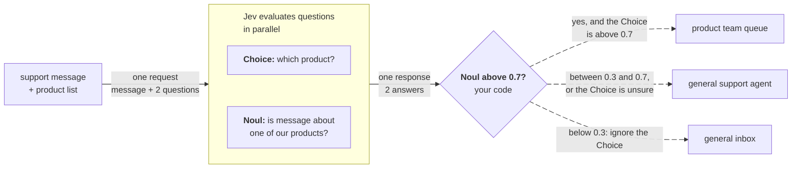

> ## Documentation Index
> Fetch the complete documentation index at: https://docs.typesafe.ai/llms.txt
> Use this file to discover all available pages before exploring further.

# Companion Noul

> Pair a Choice with a Noul that asks whether any option fits, so your code can tell when none does.

A Choice question always picks an option, even when none of them applies. Ask which of three things an input is about, and an input about none of them still gets an answer, possibly with a high probability. The model is answering the question it was asked, so it picks whichever of the three options is closest.

To fix this, add a second question to the same request: a Noul question that asks whether any of the options fits at all. Your code uses the answer to the Choice only when the Noul is a clear yes.



## Example: routing messages to product teams

Say you sell three products, and you send each support message to the relevant product team. Messages about anything else, such as a lamp from another shop or a note from a recruiter, go to a general inbox instead.

### Ask which product, and whether any fits

Both questions refer to the product list by its key in the state, `products`. Jev sees the Choice question's option names, so names such as `desk_pro` say what each product is. The `false` criterion on the Noul question lists what counts as a no: another product, a service, or something you don't sell.

Try it in the Playground →

Jev's response:

```json theme={null}
{
  "model": "jev-1.14.0",
  "answers": {
    "product": {
      "type": "choice",
      "choice": "desk_pro",
      "confidence": 0.94,
      "probabilities": {
        "desk_pro": 0.96,
        "chair_lite": 0.01,
        "monitor_arm": 0.03
      }
    },
    "about_our_product": {
      "type": "noul",
      "noul": 0.02
    }
  },
  "usage": {
    "input_tokens": 549,
    "output_tokens": 63
  }
}
```

The Choice picks `desk_pro` at 0.96, with a confidence of 0.94. Nothing in that answer tells you the message isn't about your desk. Of the three options, a desk lamp is closest to a desk. The companion Noul reads 0.02, which says the message isn't about any of your products. Here are Jev's answers for four different messages:

| Message | Choice | Top probability | Noul |
| - | - | - | - |
| "The motor on my standing desk has started making a grinding noise... the 140 cm one" | `desk_pro` | 1.00 | 0.98 |
| "The chair arrived but the monitor arm didn't. Can you check where the arm is?" | `monitor_arm` | 1.00 | 0.99 |
| "My desk lamp stopped working after two weeks..." | `desk_pro` | 0.96 | 0.02 |
| "I'm a recruiter working with several furniture retailers and wondered if your head of operations is open to a quick call" | `desk_pro` | 0.81 | 0.02 |

### Trust the Choice only when a product fits

Read the Noul first. On a clear no, ignore the Choice and send the message to the general inbox. A clear yes says the message is about one of your products, but not which one, so also check the probability of the product the Choice picked. If both are high, send the message straight to that product team. Otherwise, a general support agent decides, with the Choice's pick passed along as a suggestion.

```python title="route.py" theme={null}
YES = 0.7
NO = 0.3
PRODUCT_SURE = 0.7


def route(message_id, response):
    about_ours = response.answers["about_our_product"].noul
    product = response.answers["product"]
    product_probability = product.probabilities[product.choice]

    if about_ours < NO:
        # Nothing fits. The Choice's answer is noise; don't read it.
        send_to_general_inbox(message_id)

    elif about_ours > YES and product_probability > PRODUCT_SURE:
        # The Choice is answering a question that applies, and it clearly picked one product. Use it.
        send_to_product_team(message_id, product.choice)

    else:
        # Unsettled, or about our products but not clearly which one:
        # a person decides, with the Choice's top option as a hint.
        send_to_general_agent(message_id, suggested_product=product.choice)
```

## Why an `other` option falls short

Adding `other: 'Something else'` to the Choice question looks like less work, and it used to be the usual advice. But `other` competes with the product options for probability. A message that is partly about a product and partly about something else splits its probability between `other` and that product, and neither number tells your code what to do. With a companion Noul, the Choice question only picks among the products, and a separate question with concrete `true` and `false` criteria decides whether any product fits. In our tests, that usually works better.

> [!NOTE]
>
> [Box](https://docs.typesafe.ai/primitives/box.md), which is a question type for finding where something is in an image, has the same problem: it always returns a location in an image. Pair it with a Noul question such as "Is there a coffee mug in `photo`?" so your code knows whether the box marks a mug at all.

## Other ways to use a companion Noul

* **One Noul question per option.** When a message can be about more than one product, a Choice has to split its probability between them. Ask one Noul question per product instead, and read each one on its own. Then the case where nothing fits needs no extra question, because every Noul comes back low.
* **As a screen.** Ask a Noul question first, and run the expensive step, which may require a Choice or Score, only when the answer is a clear yes. See [screen with a Noul first](https://docs.typesafe.ai/patterns/noul-screen.md).
* **Candidates from code.** The options don't have to be a fixed list. Your code can pull possible values out of the text and use them as the options in the Choice question, and the companion Noul question asks whether the right value is among them. The [value extraction cookbook](https://docs.typesafe.ai/cookbooks/pre_parsed_value_extraction_cookbook.md) builds candidates in code this way, but it uses a `none` option instead of a companion Noul.


This documentation is built and hosted on [Mintlify](https://mintlify.com), a developer documentation platform.