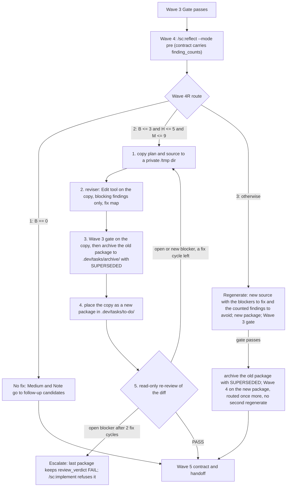

# Design: surgical remediation of a reviewed tasklist package

Grounding: `index_state: fresh` (checked 2026-11-17T19:11:39Z); codegraph tools used: `codegraph_status` only, because every target of this design is a markdown primitive, which codegraph does not index; every claim below was checked with Grep and Read.

Status: proposed design (planning only, no code). Owner order of 2026-11-17. This is a follow-up phase: it starts after the wonsol default-panel package `.dev/tasks/to-do/TASK-WF-wonsolDefaultV2-20261117-185458/` is implemented.

## 1. Problem

A `/sc:workflow` plan is reviewed by `/sc:reflect --mode pre` in the workflow's Wave 4. Today nothing in any pipeline repairs the plan from that review:

- `/sc:workflow` forbids it: "Advisory and read-only: never edit, delete, or regenerate `<id>.md` from findings" (`src/superclaude/skills/sc-workflow-protocol/SKILL.md:93`). A fix means a person re-runs `/sc:workflow` and gets a new package (`src/superclaude/skills/sc-workflow-protocol/refs/input-parse.md:20`): full regeneration.
- `/sc:reflect` is read-only on what it reviews (`src/superclaude/skills/sc-reflect-protocol/SKILL.md:167-168`). Its `--remediate` plan route builds a new plan with `sc:workflow` (`src/superclaude/skills/sc-reflect-protocol/refs/remediation-handoff.md:14`): also regeneration.
- `/sc:design` and `/sc:brainstorm` define no repair step.
- Only `/sc:spec-panel --mode critique` repairs in place: a reviser fixes only the blocking findings of a document and a re-review checks the changed lines, at most 2 fix cycles (`src/superclaude/commands/spec-panel.md:256-264`, `src/superclaude/rules/prompts/document_review_loop_prompts.md:51-54`).

Regeneration of a whole plan for a few local defects throws away text that reviewers already checked and can reintroduce defects that were absent. The worked example of 2026-11-17 (the wonsol default-panel plan): the review found 3 blocking findings, all wrong or missing sentences in 3 of 6 tasks. A copy of the plan was repaired with the Edit tool (8 calls, 12,783 to 15,524 bytes), re-reviewed twice (re-review 1 found one new blocker made by an edit; re-review 2 passed), placed as a new package, and the old package was archived. Evidence: `.dev/tasks/to-do/TASK-WF-wonsolDefaultV2-20261117-185458/artifacts/revision-2-log.md`.

A second gap: superseded packages stay in `.dev/tasks/to-do/` with only a `SUPERSEDED` line in their contract. Four such packages are there today (`TASK-WF-designSpec-20261107-072120`, `TASK-WF-designSpec-20261107-074040`, `TASK-WF-removeTheAnyIssu-20261031-235404`, `TASK-WF-removeTheAnyIssu-20261101-225338`), so `to-do/` no longer means "work to do".

## 2. Decision: where the work lives

**`sc:workflow` owns remediation; `sc:reflect` only reports counts.**

| Option | For | Against |
|---|---|---|
| A. In `sc:reflect` (a new Wave 6 route) | Reflect already has `--remediate` | Reflect's Waves 0 to 6 are read-only by design and only Wave 7 mutates, for promotion of finished work (`SKILL.md:167-168`, `:1522`); its `--remediate` is built for post-execution deviation registers; a plan edit and a package swap are package-lifecycle work that reflect does not own |
| **B. In `sc:workflow` (chosen)** | Workflow creates packages, owns their ids, collision rule and contract (`refs/input-parse.md:18-25`, `refs/return-contract.md`), and already calls the review in Wave 4, so it receives the findings where the decision is made | It reverses the "never edit or regenerate from findings" rule of `SKILL.md:93`, which this design replaces with a bounded rule |

Reflect's part is one additive contract change (section 5.1) so the decision reads numbers, not prose. Reflect's own `--remediate` plan route keeps calling `sc:workflow`, and after this change that call can use the surgical route too (section 5.4).

## 3. The routing rule

After Wave 4 returns, workflow counts the findings of the merged review and picks one route.

Counts (from the reflect contract fields of section 5.1, one count per finding, each finding counted once per field):

- `B` = findings graded Blocking (`Blocking (Decision):`, `Blocking (Missing):` or `Blocking (Safety):`, the grades of the review severity rule in `src/superclaude/agents/reflect-reviewer.md`).
- `H` = findings whose reviewer label is HIGH (the label column of the reflect reviewer's Deviations table), whatever their grade.
- `M` = findings graded Medium.

The rows are tried in order and the first match wins (L4: without an order, `B == 0` with a high `H` or `M` matched two rows):

| Order | Condition | Route |
|---|---|---|
| 1 | `B == 0` | **None**, whatever `H` and `M` are. The plan stands; Medium and Note findings are written to the contract as follow-up candidates and never start a fix pass (the severity rule). |
| 2 | `B <= 3` and `H <= 5` and `M <= 9` | **Surgical** (section 4) |
| 3 | otherwise (`B >= 1` and any of `B >= 4`, `H >= 6`, `M >= 10`) | **Regenerate** (section 4.3) |

The thresholds combine as "surgical only when all three counts are under their limits" (owner decision D1, 2026-11-17).

A `Blocking (Safety)` finding never changes the route by itself; it is repaired like any blocker, and the re-review must confirm it resolved.

## 4. The routes

### 4.1 Surgical route (default below the thresholds)

The five steps of the owner order, in the owner's order (owner decision D2, 2026-11-17: the original is archived before the re-review), with the rules that make each step safe:

1. **Duplicate.** Make a private directory `mktemp -d /tmp/sc-workflow-revise.XXXXXXXX`; copy the plan file and `source.md` of the package being repaired into it; record the sha256 of the original plan.
2. **Edit.** A reviser agent in a fresh context reads the copy and repairs **only the blocking findings**, with the Edit tool (exact, unique string replacement; one finding per call; no `sed`, no script, no whole-file rewrite). It follows the REVISE prompt and fix map of `src/superclaude/rules/prompts/document_review_loop_prompts.md:51-66`: prefer deleting or narrowing text, cite the finding id on every addition, report bytes added and deleted per finding id, end with a `fixmap-v1` block. Medium and Note findings are not touched.
3. **Archive the original.** After the repaired copy passes the Wave 3 gate of `refs/quality-gates.md`: move the original package from `.dev/tasks/to-do/<old-id>/` to `.dev/tasks/archive/<old-id>/` and add a `SUPERSEDED` line to its contract naming the new id (section 6).
4. **Place the new package.** Create `.dev/tasks/to-do/<new-id>/` under the normal id and collision rules (`refs/input-parse.md:18-25`, with `archive/` added to the collision check); put the repaired copy there as `<new-id>.md` with `slug` set to `<new-id>`; `source.md` is the old source plus a `## Revision N` section naming the old id, the review chain and the fix map; `artifacts/` holds the diff, the prior findings, a byte copy of the old plan and a revision log; the contract records `supersedes: <old-id>` and `remediation_route: surgical`.
5. **Re-review.** A read-only reviewer (agent type `reflect-reviewer`) gets the placed plan, the archived original as baseline, the `diff -w` of the two, and the prior blocking findings; it decides each prior blocker as resolved, open or regressed and grades any new finding by the severity rule (the re-review core of `document_review_loop_prompts.md:35-49`).

Fix cycles (owner decision D2): a re-review with an open or new blocker starts the next cycle, which repeats steps 1 to 5 on the package placed by the cycle before; no placed package is edited in place. At most 2 fix cycles (3 reviews in all, counting the first review). When blockers are still open after the second cycle, the last placed package stays in `.dev/tasks/to-do/`, its contract records `review_verdict: FAIL` and the open blocker ids, the run escalates to the user, and `/sc:implement` refuses a package whose contract carries `review_verdict: FAIL` (section 5.5).

### 4.2 Gates kept from today

The new plan still passes the Wave 3 gate of `refs/quality-gates.md` before it is placed (step 3). The Wave 4 review of the new package is the re-review of step 5, not a fresh full review; the contract says so (`reflect_status` records the re-review verdict and its scope, "changed lines plus prior blockers").

### 4.3 Regenerate route (above any threshold)

Today's behavior, made explicit: workflow writes a new source (the old `source.md` plus a section that lists the blocking findings to fix and, as text the new plan must not repeat, the HIGH-labelled and Medium findings that counted toward the route (L4: they triggered the route, so the new plan must not reproduce them)), runs a normal generation into a new package, and archives the old package with a `SUPERSEDED` line only after the new plan passes the Wave 3 gate (L4: a failed generation archives nothing). Wave 4 then reviews the new package; its result is routed once more with the same rule, except that the regenerate route is taken at most once per run (L4): a second regenerate result escalates to the user with the open blocker ids, and the package gets `review_verdict: FAIL` as in section 4.1. The old plan is not edited.

### 4.4 Flags

- Default: the route of section 3 runs after Wave 4.
- `--remediate none`: record the counts and the chosen route, change nothing (today's behavior).
- `--remediate surgical|regenerate`: force a route (recorded as forced).
- `/sc:workflow --revise <package-dir> --review <REPORT.md>`: run the route for a package that was reviewed outside workflow (as on 2026-11-17).
- Under `--unattended`: the surgical route runs (no person needed); escalation after 2 fix cycles ends the run `partial` with the open blockers in `unresolved`, and the last placed package keeps `review_verdict: FAIL` (owner decision D2).

## 5. Changes by file

### 5.1 `src/superclaude/skills/sc-reflect-protocol/` (contract 1.8.0 to 1.9.0, additive)

Add `finding_counts: {blocking, label_high, medium, note}` to the stable contract, computed from the merged findings after the evidence validator, in UC-1 and UC-2. No consumer changes (section 9.4 of reflect's SKILL.md: additive minor bump).

### 5.2 `src/superclaude/skills/sc-workflow-protocol/`

- `SKILL.md`: a new Wave 4R "Remediate" between Wave 4 and Wave 5 with the routing rule and both routes; replace the sentence at `SKILL.md:93` with the bounded rule; keep "never overwrite an existing package".
- `refs/input-parse.md`: the collision check of step 4 also covers `.dev/tasks/archive/<id>`; the `--revise` and `--remediate` flags.
- `refs/return-contract.md`: new fields `remediation_route`, `supersedes`, `superseded_by`, `finding_counts`, `fix_cycles`.
- A new `refs/remediation.md` for the route details (sections 3 and 4 of this design).
- `src/superclaude/commands/workflow.md`: the new flags and the Unattended rules.

### 5.3 Review-loop prompts

Reuse `src/superclaude/rules/prompts/document_review_loop_prompts.md` as written. No edit is planned there: the held stage 4 of the blocker-classification program edits that file family.

### 5.4 `src/superclaude/skills/sc-reflect-protocol/refs/remediation-handoff.md`

The plan route's Phase B (`remediation-handoff.md:81-86`) says findings never edit the tasklist and a refactor re-runs Phase A as a new package. Point it at workflow's Wave 4R instead, so the same routing rule applies.

### 5.5 `src/superclaude/skills/sc-implement-protocol/refs/managed-workspace.md`

Owner decision D2: add one managed-plan check: a plan whose package contract carries `review_verdict: FAIL` is refused before any write, with a STOP that names the open blocker ids from that contract.

## 6. Superseded packages are always archived (the standing rule)

Rule: a package replaced by another package, by either route or by hand, is moved to `.dev/tasks/archive/<id>/` in the same change that creates its replacement, with a `SUPERSEDED` line in its contract naming the replacement. It is deleted only on an explicit owner order. `/sc:implement` already refuses it there, because a managed plan must sit in `to-do/` or `done/` (`src/superclaude/skills/sc-implement-protocol/refs/managed-workspace.md:11`).

Files to update so the rule holds everywhere:

| File | Change |
|---|---|
| `.dev/README.md` | Workflow task packages section: add `archive/` (superseded, never run); the "Look in both places" bullet (`:62`) becomes three places |
| `src/superclaude/skills/sc-workflow-protocol/refs/input-parse.md` | collision check includes `archive/` (section 5.2) |
| `src/superclaude/skills/sc-workflow-protocol/SKILL.md` | Wave 4R archives on supersede (section 4.1 step 3, owner decision D2) |
| `src/superclaude/skills/sc-reflect-protocol/refs/remediation-handoff.md` | the plan route archives the package it replaces |
| `src/superclaude/core/HOW-WE-WORK.md` | level 3 row: a replaced plan moves to `.dev/tasks/archive/`; then copy the file byte for byte to `plugins/superclaude/skills/sc-recommend/refs/HOW-WE-WORK.md` and re-run the level-table copy into `src/superclaude/core/CLAUDE.md`, as the project `CLAUDE.md` requires |
| `.dev/tasks/to-do/` (data) | migration: move the four superseded packages named in section 1 to `archive/` |

## 7. Pipeline after the change

## 8. Owner decisions (2026-11-17)

- **D1. How the thresholds combine:** surgical only when all three counts are under their limits.
- **D2. Archive before or after the re-review:** before, as in the owner order (section 4.1); a failed repair leaves the last placed package with `review_verdict: FAIL`, which `/sc:implement` refuses.
- **D3. What "high" and "medium" count:** `H` counts the reviewer label HIGH; `M` counts the grade Medium.
- **D4. Default on or opt-in:** default on after Wave 4, with `--remediate none` to opt out.

## 9. Acceptance criteria for the implementation

- A plan with 1 to 3 blocking findings (and H, M under their limits) is repaired on a copy, re-reviewed, placed as a new package and the old package is archived; the old plan file is byte-identical before and after; the new package's contract names `supersedes` and `remediation_route: surgical`.
- A plan with 4 or more blockers takes the regenerate route; a plan with no blocker takes no route, whatever its `H` and `M` (L4).
- A regenerate run whose new plan fails the Wave 3 gate archives nothing, and a run takes the regenerate route at most once (L4).
- A re-review that still finds a blocker after 2 fix cycles escalates; the last placed package keeps `review_verdict: FAIL`, and `/sc:implement` refuses it (owner decision D2).
- No fix pass ever changes text for a Medium or Note finding (checked by the fix map: every `applied` id is a blocking id).
- The collision check refuses an id that exists in `archive/`; `/sc:implement` refuses a plan under `archive/`.
- After the change, `.dev/tasks/to-do/` holds no package whose contract says `SUPERSEDED`.
- Tests: unit tests for the routing rule (boundary values 3/4, 5/6, 9/10 and `B == 0`); a fixture package run through the surgical route end to end in a temporary checkout; `make verify-sync` clean.

## 10. Out of scope

The wording of the review severity rule; the reviewer models; `/sc:design` and `/sc:brainstorm` (they have no review step to remediate); `/sc:spec-panel`'s own loop; deleting archived packages.
